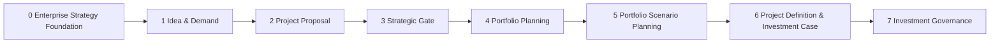
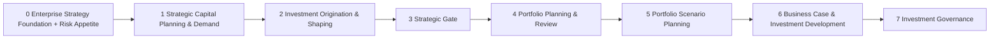
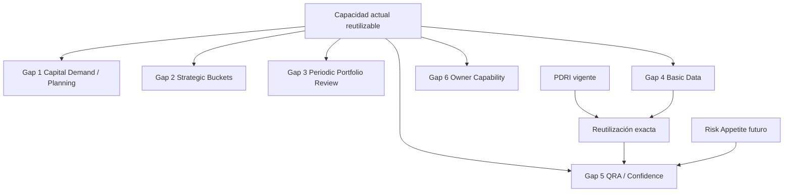
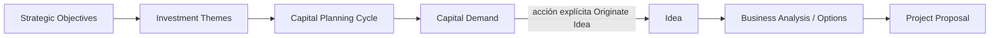
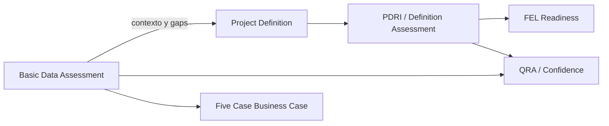
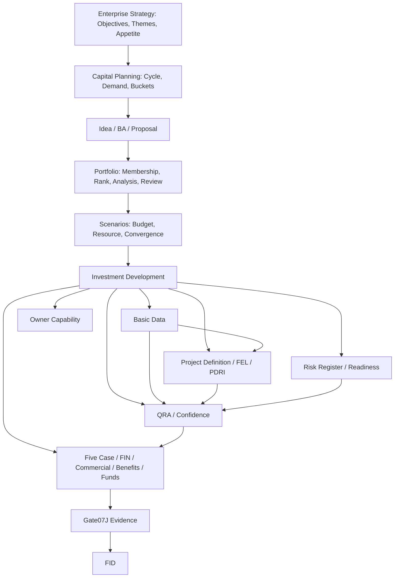
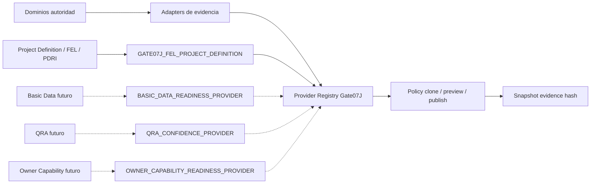
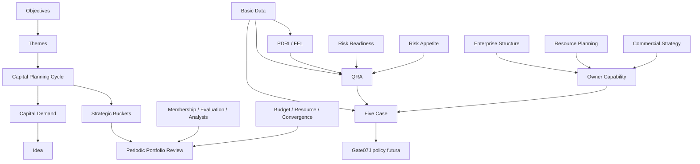
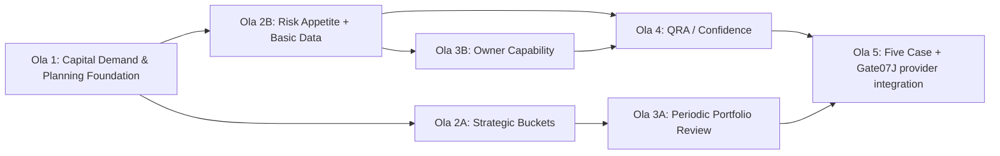

# Revisión de brechas CPIG y arquitectura objetivo con PDRI

**Producto:** P&Pmis Construction AI  
**Macroproceso:** Capital Portfolio & Investment Governance (CPIG)  
**Tipo de incremento:** revisión arquitectónica y definición de arquitectura objetivo  
**Fecha de corte:** 2026-09-21  
**Repositorio:** `pypmis-ia-sas`  
**Estado:** VALIDADO PARA PLANIFICACIÓN; SIN CAMBIOS PRODUCTIVOS

## 1. Decisión ejecutiva

El macroproceso estratégico existente ofrece una cadena gobernada desde Idea hasta Post-FID y ya dispone de autoridades sólidas para evaluación, ranking, escenarios, recomendación, Project Definition/FEL, PDRI, Five Case Business Case, preparación de Gate, FID y elegibilidad Post-FID. La revisión detecta seis capacidades todavía ausentes: Strategic Capital Demand/Capital Planning, Strategic Capital Buckets, Periodic Portfolio Review, Basic Data Readiness, QRA/Confidence y Owner Capability Readiness.

La arquitectura objetivo incorpora esos vacíos sin crear autoridades paralelas. Capital Planning no reemplaza Budget Planning; Strategic Buckets no reemplazan ranking ni escenarios; Portfolio Review no toma decisiones de Gate; Basic Data no recalcula PDRI; QRA no reemplaza Risk Register, FIN, Budget ni CPM; Owner Capability no reemplaza Resource Planning. Risk Appetite/Capacity/Thresholds se define como política compartida de Enterprise Strategy, no como evidencia ni proveedor.

PDRI no es una brecha. Se conserva la implementación vigente en Project Definition/FEL, incluidos los tipos `CUSTOM`, `PDRI_COMPATIBLE` y `FEL_INDEX_COMPATIBLE`, las evaluaciones versionadas e inmutables y el proveedor `GATE07J_FEL_PROJECT_DEFINITION`. No se crea un dominio ni un proveedor PDRI adicional.

Este incremento entrega documentación, matrices, diagramas, dependencias, olas y criterios de aceptación. No modifica modelos, migraciones, servicios, APIs, UI, providers ni políticas publicadas.

## 2. Alcance y límite de intervención

### 2.1 Incluido

- Levantamiento de la arquitectura estratégica vigente.
- Identificación y clasificación de los seis gaps.
- Definición de fases objetivo, autoridades y fronteras de dominio.
- Confirmación de PDRI y del contrato de evidencia existente.
- Definición futura de providers, sin implementarlos ni registrarlos.
- Matrices ADMIN, USER y READ_ONLY_SHARED.
- Dependencias, desempeño, historia, gobierno y Project Type.
- Roadmap por olas y recomendación del siguiente incremento.
- Informe técnico Word y registro verificable de validación.

### 2.2 Fuera de alcance y STOP explícito

- No se implementan los seis gaps.
- No se implementa Risk Appetite, Operations Readiness, Benefits Realization, Procurement execution ni Delivery execution.
- No se crean tablas, migraciones, endpoints, pantallas, rutas, módulos, providers o políticas Gate.
- No se edita una política Gate07J publicada.
- No se incorporan contenidos propietarios CII ni umbrales PDRI globales.
- No se cambia el significado histórico de Ideas, Projects, Memberships, evaluaciones, escenarios, Business Cases, Gate snapshots ni FID.

## 3. Baseline técnico verificado

| Evidencia | Resultado | Interpretación |
|---|---|---|
| Rama revisada | `main` | Arquitectura contrastada contra la rama de integración actual. |
| Commit de referencia | `9cb0969` | Punto de lectura; el árbol ya contenía cambios de incrementos previos del usuario. |
| Estado de trabajo | Dirty preexistente | Se preservaron todos los cambios; este incremento no limpia, descarta ni reinterpreta trabajo previo. |
| Alembic en código | `20260916_0061 (head)` | Cabeza de migraciones vigente en el repositorio. |
| Alembic SQLite local por defecto | `20260511_0012` | La base local por defecto está rezagada; no se usa para afirmar estado del stack desplegado. |
| Navegación estratégica | Blueprint centralizado | Fases USER 0–7 y ADMIN declaradas en un único blueprint. |
| Alcance productivo | Sin ediciones en código productivo durante esta revisión | El árbol de `backend/app`, `backend/alembic` y `frontend/src` se ancló con un hash reproducible y se volvió a comprobar al cierre; no se ejecutaron tests que mutaran estado. |

## 4. Mapa estratégico actual



La secuencia actual es coherente y no se reemplaza. El ajuste objetivo refina nombres y ubica nuevas capacidades entre las autoridades ya existentes.

## 5. Arquitectura estratégica objetivo



### 5.1 Fases objetivo

| Fase | Nombre objetivo | Capacidades principales | Autoridades reutilizadas o nuevas |
|---|---|---|---|
| 0 | Enterprise Strategy Foundation | Objectives, estructura, Project Type, gobierno, Risk Appetite futuro | Objectives y configuración existentes; política Risk Appetite futura. |
| 1 | Strategic Capital Planning & Demand | themes, horizontes, ciclos, demanda y capital indicativo | Nuevo agregado Capital Planning/Capital Demand. |
| 2 | Investment Origination & Shaping | Idea, Business Analysis, options, Proposal | Agregados existentes; origen opcional desde Capital Demand. |
| 3 | Strategic Gate | decisión estratégica sobre Proposal | Gate existente; sin mezclar FID. |
| 4 | Portfolio Planning & Review | intake, membership, evaluación, rank, análisis, buckets y review | Autoridades existentes más Bucket Plan y Review futuros. |
| 5 | Portfolio Scenario Planning | Budget, Resource y Scenario Convergence/Recommendation | Autoridades existentes. |
| 6 | Business Case & Investment Development | Basic Data, FEL/PDRI, Five Case, FIN, Risk, QRA, Permit, Commercial, Benefits, Owner Capability, Funds | Autoridades existentes y tres dominios futuros. |
| 7 | Investment Governance | Gate preparation, FID, Post-FID | Autoridades existentes. |

### 5.2 Flujo canónico end-to-end y frontera entre procesos

```text
ENTERPRISE STRATEGY
  → STRATEGIC CAPITAL PLANNING
  → CAPITAL DEMAND
  → IDEA / INVESTMENT ORIGINATION
  → BUSINESS ANALYSIS / SHAPING
  → PROJECT PROPOSAL
  → STRATEGIC GATE
  → PORTFOLIO INTAKE / PRIORITIZATION
  → PORTFOLIO SCENARIOS / ALLOCATION
  → BUSINESS CASE & BENEFITS ↔ INVESTMENT DEVELOPMENT
       ├─ Basic Data
       ├─ Project Definition / FEL / PDRI
       ├─ Commercial & Contracting Strategy
       ├─ Risk / Permit
       ├─ QRA / Confidence
       └─ Owner Capability
  → GATE PREPARATION
  → FID
  → POST-FID GOVERNANCE
```

Este es el flujo canónico para nuevos programas de capital Owner; las Ideas standalone vigentes no requieren una Capital Demand retroactiva. Business Case e Investment Development son iterativos y coexisten durante FEL, por eso la flecha es bidireccional y no se impone una serialización artificial. Strategic Capital Planning define necesidad y horizonte; Portfolio Management evalúa/prioriza/asigna; Investment Shaping formula alternativas; Business Case & Benefits sintetiza la justificación; Investment Development produce evidencia técnica; Investment Governance prepara el Gate y decide FID con autoridad propia.

### 5.3 Principios y navegación futura

`REUSE BEFORE CREATE`, `SINGLE SOURCE OF TRUTH`, `LOW COUPLING`, `MODULAR MONOLITH`, `ADMIN ≠ USER`, `READINESS ≠ DECISION`, `PORTFOLIO RANK ≠ GATE SCORE`, `RISK READINESS ≠ QRA`, `BUDGET ≠ FUNDING`, `FUNDING ≠ FIN`. Project sigue siendo una `EnterpriseWorkspace` de Workspace Type `PROJECT`; se usa la terminología Workspace, Workspace Type, Workspace Instance, Project Workspace y Enterprise Structure & Workspace Manager.

La navegación USER conservaría las fases 0–7 y añadiría Capital Planning/Demand en la 1, Buckets/Review en la 4 y Basic Data/QRA/Owner Capability en la 6; la navegación ADMIN ubicaría políticas/catálogos equivalentes en sus secciones de configuración. Esto es una recomendación, no una modificación del frontend. Se retienen conceptos de readiness, must-meet, decision hurdles, success criteria, buckets, Portfolio Review y gobierno adaptativo por riesgo, sin copiar etapas de lanzamiento de producto ni actividades de marketing.

## 6. Superposición de brechas



## 7. Matriz integral de gaps

| Gap | Business Purpose | Current Coverage | Missing Capability | Existing Reuse | New Domain Required? | ADMIN Scope | USER Scope | Provider Needed? | Gate07J Impact | Portfolio Impact | Dependencies | Historical Risk | Complexity | Recommended Wave | Recommendation |
|---|---|---|---|---|---|---|---|---|---|---|---|---|---|---|---|
| Capital Demand / Planning | Capturar necesidad de capital previa a solución | Idea/BA/Proposal existen | Cycle, Theme, Demand, origen trazable | Objectives, workspace, Idea | Sí: Strategic Capital Planning | Themes, drivers, horizons, lifecycle | Ciclos, demandas, endorsement, Originate Idea | No | Contexto Strategic Case; no evidence | Horizon/pipeline preliminar | Objectives, catálogos, Idea | No backfill Ideas; origen nullable | Media-alta; nueva identidad | 1 | Demanda separada y conversión idempotente; sin Project/Budget |
| Strategic Capital Buckets | Gobernar targets/rangos por periodo | Priority/risk bucket solo analíticos | Bucket Plan, target, assignment y posiciones | Membership, Evaluation, Budget, Resource, Gate07I | Sí: agregado en Capital Planning/Portfolio | Catálogo, bases, tolerancias | Plan, targets, assignments | No | Contexto congelado, no provider | Balance actual/recommended/approved | Capital Planning, Membership, escenarios | Frozen hashes no se recalculan | Media; agregación cross-domain | 2A | Targets no alteran ranking ni Budget |
| Periodic Portfolio Review | Revisar cartera y acciones periódicas | Fuentes Portfolio existen; sin sesión | Review Session/Snapshot/Action | Membership, rank, analysis, scenarios, Gate | Sí: Portfolio Governance | Cadencia, templates, SoD, freshness | Abrir, congelar, decidir y seguir | No inicialmente | Contexto, nunca FID | Disposiciones y rebalanceo por autoridad | Buckets y fuentes Portfolio | Sesión closed inmutable | Alta; snapshots a escala | 3A | No GO/HOLD/RECYCLE/KILL; sin edición de fuentes |
| Basic Data Readiness | Medir cobertura/calidad de datos base | Business Case NOT_AVAILABLE | Requirements/Assessment/gaps | Evidencia documental, FEL/PDRI | Sí: Project Basic Data | Taxonomía, applicability, thresholds | Evaluar, validar, gap, reassess | Sí, futuro | Class B Selection; A FFA por policy | Confianza de cartera | Project Type, FEL, Gate | Completed inmutable; no re-score PDRI | Media-alta; tailoring | 2B | Exact denominator y evidencia vigente |
| QRA / Confidence | Cuantificar incertidumbre costo/plazo | Business Case NOT_AVAILABLE | Modelo probabilístico, run, assessment | Risk, PDRI, Basic Data, bases cost/schedule | Sí: Project QRA | Método, applicability, quality | Preparar/importar, revisar, completar | Sí, futuro | B Selection; A FFA por risk policy | Confianza de escenarios | Basic Data, Risk, PDRI, Appetite | Runs/hash frozen; no trials en Gate | Alta; compute intensivo | 4 | No Risk Register/FIN/Budget/CPM paralelos |
| Owner Capability Readiness | Evaluar competencia Owner | Business Case NOT_AVAILABLE | Framework/Assessment/gaps | Enterprise Structure, Resource, Commercial | Sí: Owner Capability | Dimensiones, escalas, blockers | Evaluar, mitigar, reassess | Sí, futuro | B Selection; A FFA si aplica | Riesgo de ejecución | Org, Resource, Commercial | Completed inmutable | Media; assessments | 3B | No modifica FTE/capacity ni delivery approach |

Risk Appetite/Capacity/Thresholds se analiza como política transversal y prerrequisito de interpretación, no como séptimo gap primario ni como provider.

## 8. Current versus target

| Process Area | Current P&Pmis | CPIG Target | Gap | Action |
|---|---|---|---|---|
| Enterprise objectives | Implementado | Se conserva | Ninguno | REUSE como autoridad estratégica. |
| Enterprise/workspace structure | Implementado | Se conserva | Ninguno | REUSE jerarquía y scopes. |
| Project Type catalog | Seed limitado | Tailoring gobernado extensible | Taxonomía sectorial/mappings | EXTEND configuración; no hardcodear. |
| Governance model | Implementado | Independiente de Project Type | Ninguno | REUSE; CAPITAL_OWNER default, otros opt-in. |
| Risk Appetite | Ausente | Política versionada compartida | Política empresarial | NEW futuro en fase 0; sin provider. |
| Strategic Investment Themes | Ausente | Catálogo N:M con Objectives | Themes/Arenas | NEW futuro en Capital Planning. |
| Capital Planning Cycle | Ausente | Horizonte, drivers y plan | Ciclo gobernado | NEW futuro. |
| Capital Demand | Ausente | Identidad previa a Idea | Demanda separada | NEW futuro; origen explícito/idempotente. |
| Idea lifecycle | Implementado | Idea de Demand o standalone | Origen opcional | EXTEND por referencia; no cambiar identidad. |
| Business Analysis/options | Implementado | Se conserva | Ninguno | REFERENCE contexto de origen. |
| Project Proposal | Implementado | Se conserva | Ninguno | REUSE autoridad. |
| Strategic Gate | Implementado | Se conserva | Ninguno | REUSE; distinto de FID. |
| Portfolio Membership/intake | Implementado | Se conserva | Ninguno | REUSE pertenencia por Portfolio. |
| Portfolio Evaluation/rank | Implementado | Se conserva | Ninguno | REUSE rank contextual único. |
| Portfolio Analysis/map/scorecard | Implementado | Se conserva | Ninguno | REUSE; etiquetas actuales no son Buckets. |
| Strategic Capital Buckets | Ausente | Plan y targets por periodo | Buckets estratégicos | NEW futuro; posiciones derivadas. |
| Periodic Portfolio Review | Ausente | Sesión/snapshot congelado | Review governance | NEW futuro; no decide Gate. |
| Budget Scenario | Implementado | Se conserva | Ninguno | REUSE autoridad financiera Portfolio. |
| Resource Scenario | Implementado | Se conserva | Ninguno | REUSE autoridad de recursos. |
| Scenario convergence/recommendation | Implementado | Se conserva | Ninguno | REUSE Gate07I; no FID. |
| Basic Data Readiness | Ausente | Assessment versionado | Datos base y cobertura | NEW futuro y provider posterior. |
| Project Definition/FEL | Implementado | Se conserva | Ninguno | REUSE madurez de definición. |
| PDRI/Definition Assessment | Implementado | Se reutiliza exacto | Ninguno | REUSE; no crear domain/provider paralelo. |
| Risk Register/Readiness | Implementado | Se conserva | Ninguno | REUSE riesgos discretos; no QRA. |
| QRA/Confidence | Ausente | Probabilístico gobernado | QRA | NEW futuro y provider posterior. |
| Owner Capability | Ausente | Assessment de competencia | Owner capability | NEW futuro y provider posterior. |
| Five Case Business Case | Implementado | Consume futuras fuentes | Referencias futuras | EXTEND por referencia; no recalcular. |
| Strategic Benefits Plan | Implementado | Se conserva | Ninguno | REUSE; no crear nuevo Benefit domain. |
| Economic/Financial model | Implementado | Se conserva | Ninguno | REUSE NPV/IRR y métricas FIN. |
| Commercial & Contracting Strategy | Implementado | Se conserva | Ninguno | REUSE delivery/contracting approach. |
| Funds/funding readiness | Implementado | Se conserva | Ninguno | REUSE; Funding ≠ Budget ≠ FIN. |
| Permit readiness | Implementado | Se conserva | Ninguno | REUSE provider actual. |
| Gate07J preparation/evidence | Implementado | Policy futura con 3 providers | Evidencias nuevas | EXTEND mediante clone/preview/publish. |
| FID | Implementado | Se conserva | Ninguno | REUSE decisión de inversión única. |
| Post-FID eligibility | Implementado | Se conserva | Ninguno | REUSE; no Delivery execution. |

## 9. Strategic Capital Demand y Capital Planning

### 9.1 Propósito y autoridad

Capital Demand representa una necesidad estratégica antes de definir una solución. Debe registrar driver, necesidad de negocio o activo, urgencia, horizonte, sponsor, localización/ámbito, estimación indicativa, incertidumbre y Portfolio potencial. No es Idea, Project, Budget Target, funding request ni modelo FIN.



### 9.2 Reglas de diseño

- Una demanda puede originar varias Ideas controladas; cada relación conserva ID, snapshot y hash del origen.
- Aprobar una demanda no crea automáticamente una Idea.
- `Originate Idea` debe ser idempotente y auditable.
- Ideas históricas y standalone mantienen `source_capital_demand_id = null`.
- Strategic Investment Theme es catálogo gobernado, distinto de Objective, Idea Category y Bucket.
- La necesidad de capital es indicativa; no crea asignación presupuestal, funding ni cash flow.
- No crea Project, Membership, rank ni scenario.

### 9.3 Criterios de aceptación

- Identidad separada y lifecycle explícito.
- Conversión a Idea sin duplicados.
- Trazabilidad Objective → Theme → Cycle → Demand → Idea.
- No efectos secundarios sobre Portfolio, Budget, FIN o Gate.

## 10. Strategic Capital Buckets

Un bucket estratégico expresa intención de asignación por periodo, Objective/Theme y base configurada. No es un ranking. Su catálogo, targets, min/max, moneda cuando aplique, tolerancias y reglas pertenecen a Capital Planning; su consumo y asignación formal pertenecen al contexto de Portfolio y `portfolio_membership_id`.

### 10.1 Posiciones derivadas

| Posición | Fuente autoridad |
|---|---|
| Target/min/max | Bucket Allocation Plan publicado. |
| Actual | Membership más demanda/costo vigente. |
| Recommended | Scenario Convergence/Gate07I. |
| Approved | FID/Gate07K. |
| Resource position | Resource Scenario. |
| Rank | Portfolio Evaluation/Gate07E. |

Cambiar un target no cambia rank; reasignar un bucket no cambia Budget/Resource Scenario. Los escenarios congelan policy/assignment hash y se vuelven `STALE` si cambia una dependencia.

## 11. Periodic Portfolio Review

Portfolio Review es un agregado de gobernanza periódica y no un Project Gate. Cada sesión congela IDs y hashes de Membership, Evaluation/Rank, Investor Map/Scorecard, Budget/Resource Scenarios, Gate07I recommendation, Gate status, readiness/risk summaries y bucket allocations.

### 11.1 Acciones permitidas

| Acción de review | Semántica | Lo que no hace |
|---|---|---|
| RETAIN_PRIORITY | Disposición registrada | No congela ni recalcula rank. |
| ACCELERATE / DEFER | Solicita nuevo escenario | No edita fechas o presupuesto directamente. |
| HOLD_FOR_CAPACITY | Disposición Portfolio | No equivale a Gate HOLD. |
| REQUEST_REASSESSMENT | Crea work item | No modifica assessment terminal. |
| MOVE_BETWEEN_BUCKETS | Solicita cambio a autoridad Bucket | No cambia rank. |
| REBALANCE_CAPITAL / RESOURCES | Inicia nueva revisión de escenario | No edita escenarios frozen. |
| REMOVE_FROM_ACTIVE_PORTFOLIO | Solicita cierre lógico de Membership | No borra Project ni evidencia. |

Cadencias: monthly, quarterly, semiannual, annual y ad hoc. El vencimiento alerta; nunca decide automáticamente. El review no puede emitir GO, HOLD, RECYCLE, KILL ni FID.

## 12. Basic Data Readiness

Basic Data gobierna la aplicabilidad, disponibilidad, validación, calidad, confianza, vigencia y evidencia de categorías técnicas; no almacena diseños ni duplica documentos.



### 12.1 Tailoring y madurez

- FEL-1: inventario preliminar.
- FEL-2 / Investment Selection: cobertura crítica según Project Type, sector, localización, complejidad, riesgo e incertidumbre.
- FEL-3 / FFA: evidencia validada, vigente y blockers críticos resueltos.
- PYP-INV-SELECT: Class B por defecto, con override A para alta incertidumbre/riesgo.
- PYP-FFA: Class A blocking, `EACH_PROJECT`, cobertura exacta de ítems aplicables.
- La vigencia se define por categoría; no existe un TTL universal.

Basic Data puede explicar o bloquear readiness de Project Definition conforme a política, pero jamás cambia el score PDRI.

## 13. PDRI y Project Definition/FEL: reutilización exacta

### 13.1 Estado actual confirmado

| Aspecto | Implementación vigente |
|---|---|
| Autoridad | `project_definition` / Project Definition & FEL. |
| Assessment | `ProjectDefinitionAssessment`, relación 1:N por Project y versión. |
| Tipos de framework | `CUSTOM`, `PDRI_COMPATIBLE`, `FEL_INDEX_COMPATIBLE`. |
| Aplicabilidad | Configurada por tenant, enterprise, business unit, Portfolio y Project Type; orientación `CAPITAL_OWNER`. |
| Inmutabilidad | Completed, superseded y voided son terminales; reassessment crea nueva versión. |
| Readiness | Exige source/framework vigente, assessment completed y etapa/política aplicable. |
| Blockers | Score/maturity cuando aplique, elementos blocking, acciones abiertas blocking y evidencia faltante. |
| Evidencia Gate | `PROJECT_DEFINITION_READINESS` con FEL, framework, versión, hash, fecha, scores, coverage, blockers y source_current. |
| Provider exacto | `GATE07J_FEL_PROJECT_DEFINITION`. |

Un buen score agregado no neutraliza un elemento blocking, una acción blocking abierta o evidencia requerida faltante. Los umbrales son de configuración/política; no se introduce un umbral global ni contenido propietario.

### 13.2 Fronteras semánticas

- PDRI ≠ FEL: PDRI es un método/assessment; FEL es etapa y madurez de definición.
- PDRI ≠ Basic Data: Basic Data mide disponibilidad/calidad de datos; PDRI mide definición.
- PDRI ≠ QRA: QRA mide incertidumbre probabilística.
- El futuro Basic Data y QRA consumen referencias PDRI; no lo recalculan.
- Gate07J conserva un solo adapter y una sola fuente para Project Definition/FEL/PDRI.

### 13.3 Madurez progresiva y Gates

| Gate / etapa | PDRI/FEL actual | Basic Data futuro | QRA futuro | Owner Capability futuro |
|---|---|---|---|---|
| PYP-INV-SELECT / FEL-2 | Assessment completed/current con framework y blockers conforme a policy; sin umbral global | Class B / preliminar con cobertura crítica configurada; A si riesgo alto | Class B / preliminar según aplicabilidad; puede ser NOT_REQUIRED por policy | Class B / preliminar para CAPITAL_OWNER cuando aplique |
| PYP-FFA / FEL-3 | Assessment completed/current y requisitos estrictos efectivos; blockers/action/evidence pueden impedir READY | Class A, EACH_PROJECT, categoría aplicable y vigencia estricta | Class A si tamaño/riesgo/complejidad/incertidumbre lo exige; excepción B/C explícita | Class A para CAPITAL_OWNER aplicable; no imponer a otros modelos |

Las clases y estados `NOT_REQUIRED`, `PRELIMINARY`, `REQUIRED` y `STRICT / FID READY` son semántica de diseño futuro, nunca valores globales hardcoded. La configuración publicada determina alcance, denominador, umbral, freshness y bloqueo en cada Gate. PDRI mantiene su lógica real actual hasta un cambio de policy gobernado.

## 14. QRA / Confidence

QRA gobierna distribuciones, correlaciones, incertidumbre, P-values, drivers y recomendación de contingencia. Sus límites son estrictos:

- Risk Register mantiene riesgos discretos y tratamientos.
- QRA no escribe el Risk Register.
- FIN conserva NPV/IRR y métricas económicas.
- Budget conserva asignación y factibilidad financiera Portfolio.
- Project Definition/PDRI conserva madurez de definición.
- Scheduling conserva la lógica CPM; QRA solo referencia la base congelada.
- La contingencia recomendada no es contingencia aprobada ni Management Reserve.
- No se guardan millones de trials en OLTP ni en el snapshot Gate; solo resumen y artifact hash.

El provider futuro expone modelo/revisión/hash, bases, P-values, confidence de costo/plazo, contingencia recomendada, fecha risk-adjusted, top drivers, calidad, cobertura y contrato estándar. Investment Selection usa Class B/preliminar; FFA puede exigir Class A a `CAPITAL_OWNER` según política. Risk Appetite interpreta aceptabilidad, pero no es requisito para ejecutar la simulación.

## 15. Owner Capability Readiness

Owner Capability evalúa si la organización puede gobernar y entregar; Resource Planning cuantifica disponibilidad. Reutiliza en lectura Enterprise Structure, roles, Resource Capacity, Project Definition, Commercial Strategy, Risk/Permit y sponsor/governance model.

Commercial Strategy conserva la autoridad del delivery/procurement approach. Owner Capability solo evalúa la capacidad del Owner para ejecutarlo. Operations Readiness permanece fuera del alcance.

Investment Selection usa Class B/preliminar; FFA usa Class A cuando la política `CAPITAL_OWNER` lo exige. `CONTRACTOR_DELIVERY`, `DIRECT_INTERNAL` y `LEGACY_UNCLASSIFIED` no heredan requisitos owner automáticamente.

## 16. Risk Appetite, Capacity y Thresholds

La política futura pertenece a Enterprise Strategy Foundation:

| Concepto | Definición | Uso |
|---|---|---|
| Risk Capacity | Máximo de exposición que la organización puede soportar | Límite superior de gobierno. |
| Risk Appetite | Exposición objetivo que acepta perseguir | Contexto de estrategia y Portfolio. |
| Threshold | Disparador cuantitativo/cualitativo de escalamiento o decisión | QRA, Risk Readiness y Gate criteria. |

Cada política define scope, periodo, métrica/unidad, autoridad de aceptación, fecha efectiva, versión y hash. Es una política compartida, no evidence readiness y no requiere provider. Los consumidores deben referir `policy_id/hash`; lo histórico permanece autocontenido.

## 17. Mapa de autoridades de dominio



### 17.1 Ownership y no duplicación

| Concepto | Única autoridad | Consumidores | Prohibición |
|---|---|---|---|
| Objective | Enterprise Strategy | Planning, Idea, Portfolio, Business Case | No copiar objectives en cada dominio. |
| Demand | Capital Planning | Idea origin, Portfolio outlook | No usar Idea como Demand. |
| Rank | Portfolio Evaluation | Analysis, scenarios, Review | No persistir rank en Buckets/Review. |
| Bucket target | Capital Planning/Bucket Plan | Portfolio y scenarios | No convertirlo en Budget allocation. |
| Membership | Portfolio Membership | Rank, scenarios, Review | No crear pertenencia implícita. |
| Budget allocation | Budget Scenario | Recommendation, Review, Gate context | No crearla en Capital Planning. |
| Resource allocation | Resource Scenario | Recommendation, Review | No crearla en Owner Capability. |
| Risk item | Risk Register | Readiness, QRA | QRA no lo reescribe. |
| Definition maturity | Project Definition/PDRI | QRA, Business Case, Gate | Basic Data no calcula score. |
| Economic metric | FIN | Business Case, Gate | QRA no calcula NPV/IRR. |
| Investment decision | FID | Post-FID | Review/Gate readiness no decide FID. |

### 17.2 Matriz de propiedad y snapshots

| Business Concept | Source of Truth | Consumers | Mutation Authority | Historical Snapshot Owner |
|---|---|---|---|---|
| Strategic Objective | Enterprise Strategy Foundation | Capital Planning, Idea, Portfolio, Business Case | ADMIN configurador/publicador | Cada ciclo/demanda/caso referencia ID/hash efectivo |
| Capital Demand | Strategic Capital Planning futuro | Idea, Portfolio outlook | USER del planning cycle | Demand terminal y Idea origin snapshot/hash |
| Idea | Idea Lifecycle | BA, Proposal, Portfolio | USER Idea workflow | Idea revision/origin frozen |
| BA / Options | Business Analysis | Proposal, Strategic Gate, Business Case | USER BA workflow | BA revision y Proposal refs |
| Portfolio Rank | Portfolio Evaluation | Analysis, scenarios, Review | USER evaluación gobernada | Evaluation/Review snapshot |
| Strategic Bucket | Bucket Allocation Plan futuro | Portfolio, Review, scenarios | ADMIN catálogo; USER plan/assignment | Allocation Plan y scenario hash |
| Budget Scenario | Portfolio Budget | Recommendation, Review, Gate context | USER Budget Scenario | Frozen scenario y Gate07I |
| Resource Scenario | Portfolio Resource | Recommendation, Review | USER Resource Scenario | Frozen scenario y Gate07I |
| Business Case | Business Case Manager | Gate07J, FID | USER Business Case workflow | Completed case revision/Gate package |
| Benefit | Strategic Benefits Plan | Business Case, FID, future realization | USER Benefits Plan workflow | Benefits revision y FID Success Criteria Snapshot |
| Basic Data | Project Basic Data futuro | FEL/PDRI context, QRA, Business Case, Gate | USER assessment; ADMIN policy | Completed assessment/provider hash |
| FEL / PDRI | Project Definition | QRA, Business Case, Gate07J | USER Project Definition assessment; ADMIN framework | Completed immutable assessment y Gate evidence |
| Commercial & Contracting Strategy | Commercial Strategy | Owner Capability, Business Case, Gate | USER Commercial workflow; ADMIN policy | Completed strategy/provider hash |
| Risk Register / Readiness | Risk domain | QRA, Business Case, Gate | USER Risk workflow; ADMIN policy | Completed risk/readiness evidence |
| QRA | Project QRA futuro | Business Case, Gate, Portfolio confidence | USER QRA review; ADMIN method | Completed run summary/model hash |
| Funding | Funds Manager | Business Case, Gate07J, FID | USER funding workflow; ADMIN policy | Funding evidence/Gate package |
| FIN | Economic Financial Model | Business Case, Gate, FID | USER FIN model; ADMIN policy | Completed FIN revision/provider hash |
| Owner Capability | Owner Capability futuro | Business Case, Gate | USER assessment; ADMIN framework | Completed assessment/provider hash |
| Gate Evidence | Gate07J preparation/policy | FID | USER package preparation; ADMIN published policy | Frozen Gate07J evidence package |
| FID Decision | Investment Decision | Post-FID | Authorized FID decision workflow | Immutable FID and success criteria snapshot |

### 17.3 Reuse / Extend / Reference / New Domain

| Propuesta | Clasificación | Módulos cercanos | Límite |
|---|---|---|---|
| Capital Planning + Demand | NEW DOMAIN; REUSE Objectives/workspace | Idea, BA, Proposal | Idea se origina explícitamente, no se sustituye. |
| Strategic Buckets | NEW DOMAIN/AGGREGATE; REFERENCE Portfolio | Evaluation, Analysis, Budget, Resource | No rank/budget/resource paralelo. |
| Periodic Review | NEW DOMAIN; REFERENCE fuentes | Membership, Evaluation, scenarios, Gate | No modifica fuentes ni decide Gate. |
| Basic Data | NEW DOMAIN; REFERENCE documentos y PDRI | Project Definition/FEL, Business Case | No crea segundo PDRI. |
| QRA | NEW DOMAIN; REFERENCE Risk/PDRI/FIN bases | Risk, FIN, Budget, Permit | No Risk Register/FIN/CPM paralelo. |
| Owner Capability | NEW DOMAIN; REFERENCE estructura/capacity | Resource, Commercial, Risk | No FTE plan ni contracting strategy. |
| Risk Appetite | EXTEND Enterprise Strategy config/policy | Risk Readiness, QRA, Gate | Política, no evidencia. |
| PDRI | REUSE exacto | Project Definition/FEL y Gate07J | No nuevo dominio/provider. |
| Benefits/Success Criteria | REUSE exacto | Strategic Benefits Plan, FID snapshot | No crear nuevo Benefit domain. |

## 18. Arquitectura de providers



### 18.1 Registro vigente relevante

| Provider | Evidence / fuente | Decisión |
|---|---|---|
| GATE07I_PORTFOLIO_RECOMMENDATION | Portfolio recommendation | Reutilizar. |
| GATE07G_BUDGET_FEASIBILITY | Budget feasibility | Reutilizar. |
| GATE07H_RESOURCE_FEASIBILITY | Resource feasibility | Reutilizar. |
| GATE07J_FEL_PROJECT_DEFINITION | Project Definition, FEL y PDRI aliases | Reutilizar exacto; no duplicar. |
| GATE07J_FUND_FUNDING_READINESS | Funding readiness | Reutilizar. |
| RISK_READINESS_PROVIDER | Risk readiness | Reutilizar; no QRA ni Appetite. |
| PERMIT_READINESS_PROVIDER | Permit readiness | Reutilizar. |
| BUSINESS_CASE_READINESS_PROVIDER | Five Case readiness | Reutilizar. |
| ECONOMIC_FINANCIAL_READINESS_PROVIDER | FIN readiness | Reutilizar. |
| BENEFITS_READINESS_PROVIDER | Benefits readiness | Reutilizar. |
| COMMERCIAL_READINESS_PROVIDER | Commercial readiness | Reutilizar. |

La matriz siguiente refleja el `PROVIDER_REGISTRY` actual. `AVAILABLE` designa disponibilidad del contrato/adapter en código, no significa que todo provider sea obligatorio en cada política Gate publicada.

| Provider | Status | Source Module | Evidence Type | Scope | Current availability | Future need | Gate usage |
|---|---|---|---|---|---|---|---|
| GATE07I_PORTFOLIO_RECOMMENDATION | AVAILABLE | PORTFOLIO_SCENARIO_CONVERGENCE | PORTFOLIO_RECOMMENDATION | PORTFOLIO, PROJECT_SET | Registry/adapter vigente | Reusar | Convergencia contextual |
| GATE07G_BUDGET_FEASIBILITY | AVAILABLE | PORTFOLIO_BUDGET | BUDGET_FEASIBILITY | PORTFOLIO, PROJECT_SET | Registry/adapter vigente | Reusar | Factibilidad capital |
| GATE07H_RESOURCE_FEASIBILITY | AVAILABLE | PORTFOLIO_RESOURCE | RESOURCE_FEASIBILITY | PORTFOLIO, PROJECT_SET | Registry/adapter vigente | Reusar | Factibilidad recursos |
| GATE07J_FEL_PROJECT_DEFINITION | AVAILABLE | PROJECT_DEFINITION_FEL | PROJECT_DEFINITION_READINESS; FEL/PDRI por matriz | EACH_PROJECT, SELECTED_PROJECTS_ONLY | Registry/adapter vigente | Reusar exacto | Definition/FEL/PDRI |
| GATE07J_FUND_FUNDING_READINESS | AVAILABLE | FUNDS_MANAGER | FUNDING_READINESS | PORTFOLIO, PROJECT_SET | Registry/adapter vigente | Reusar | Funding |
| RISK_READINESS_PROVIDER | AVAILABLE | RISK_READINESS | RISK_READINESS | PORTFOLIO, PROJECT_SET, EACH_PROJECT | Registry/adapter vigente | Reusar | Risk readiness, no QRA |
| PERMIT_READINESS_PROVIDER | AVAILABLE | PERMIT_READINESS | PERMIT_READINESS | PROJECT_SET, EACH_PROJECT, SELECTED_PROJECTS_ONLY | Registry/adapter vigente | Reusar | Permit |
| BUSINESS_CASE_READINESS_PROVIDER | AVAILABLE | BUSINESS_CASE_MANAGER | BUSINESS_CASE_READINESS | EACH_PROJECT, SELECTED_PROJECTS_ONLY | Registry/adapter vigente | Reusar | Five Case |
| ECONOMIC_FINANCIAL_READINESS_PROVIDER | AVAILABLE | ECONOMIC_FINANCIAL_MODEL | ECONOMIC_FINANCIAL_READINESS | EACH_PROJECT, SELECTED_PROJECTS_ONLY | Registry/adapter vigente | Reusar | FIN |
| BENEFITS_READINESS_PROVIDER | AVAILABLE | STRATEGIC_BENEFITS_PLAN | BENEFITS_PLAN_READINESS | EACH_PROJECT, SELECTED_PROJECTS_ONLY | Registry-only en policy vigente | Reusar | Future policy si corresponde |
| COMMERCIAL_READINESS_PROVIDER | AVAILABLE | COMMERCIAL_CONTRACTING_STRATEGY | COMMERCIAL_READINESS | EACH_PROJECT, SELECTED_PROJECTS_ONLY | Registry-only en policy vigente | Reusar | Future policy si corresponde |

### 18.2 Decisiones futuras

| Capacidad | Provider futuro | Momento de alta | Decisión actual |
|---|---|---|---|
| Basic Data | `BASIC_DATA_READINESS_PROVIDER` | Después de implementar y validar el dominio | No implementar ahora. |
| QRA | `QRA_CONFIDENCE_PROVIDER` | Después de Basic Data, PDRI, Risk y Appetite | No implementar ahora. |
| Owner Capability | `OWNER_CAPABILITY_READINESS_PROVIDER` | Después de implementar y validar el assessment | No implementar ahora. |
| PDRI | Ninguno nuevo | N/A | Reusar `GATE07J_FEL_PROJECT_DEFINITION`. |
| Capital Planning | Ninguno | N/A | Contexto, no evidence readiness. |
| Portfolio Review | Ninguno inicialmente | Revisar solo si política futura lo exige | Contexto congelado, no provider. |
| Risk Appetite | Ninguno | N/A | Política, no evidencia. |

| Provider futuro | Status | Source Module | Evidence Type conceptual | Scope conceptual | Current availability | Future need | Gate usage conceptual |
|---|---|---|---|---|---|---|---|
| BASIC_DATA_READINESS_PROVIDER | PROPOSED, not registered | PROJECT_BASIC_DATA | BASIC_DATA_READINESS | EACH_PROJECT; PROJECT_SET summary | NOT_AVAILABLE | Dominio/config/adapter/test antes de policy | Class B Selection; Class A FFA según tailoring |
| QRA_CONFIDENCE_PROVIDER | PROPOSED, not registered | PROJECT_QRA | QRA_CONFIDENCE | EACH_PROJECT; PROJECT_SET summary | NOT_AVAILABLE | Basic Data/PDRI/Risk/bases y Risk Appetite | Class B Selection; A FFA según riesgo |
| OWNER_CAPABILITY_READINESS_PROVIDER | PROPOSED, not registered | OWNER_CAPABILITY | OWNER_CAPABILITY_READINESS | EACH_PROJECT; PROJECT_SET summary | NOT_AVAILABLE | Assessment/config/adapter/test | Class B Selection; A FFA si aplica |

### 18.2.1 Criterios de decisión futura por provider

| Evidencia | Decision Criteria conceptual | Quality/Confidence | Freshness | Coverage |
|---|---|---|---|---|
| BASIC_DATA_READINESS | Must-meet de datos críticos por Gate/Project Type | validación y confianza por categoría | TTL por categoría; source_current/hash | Numerador y denominador exactos de categorías aplicables |
| QRA_CONFIDENCE | P-values/hurdles comparados con Risk Appetite; no aprobación de contingencia | model quality, calibración, incertidumbre | input/model/run hash y as_of_date vigentes | Project Set exacto y missing explicitados |
| OWNER_CAPABILITY_READINESS | Gaps críticos y mitigaciones obligatorias | evidencia/escala y reviewer | org/resource/commercial refs vigentes | Dimensiones aplicables y Projects exactos |

Ningún criterio conceptual altera hoy `EVIDENCE_TYPES` o políticas publicadas. Los nuevos evidence types deberán añadirse y validarse solo cuando exista su dominio y provider.

### 18.3 Contrato estándar

Todo provider Gate07J debe entregar exactamente los campos base vigentes: `evidence_type`, `scope`, `readiness_status`, `source_current`, `evidence_hash`, `as_of_date`, `warnings` y `blockers`. Los futuros providers añaden `configuration_id/revision/hash`, `source_record_id/version`, `project_workspace_id`, `project_set_hash` cuando aplique, `quality`, `confidence`, `coverage`, source references y `can_supply_investment_gate_evidence`.

Una policy publicada nunca se muta silenciosamente: el alta de evidence/provider será un incremento separado con clone, preview, publish, hash nuevo y protección histórica.

## 19. Matriz ADMIN / USER / READ_ONLY_SHARED

| Capacidad | ADMIN | USER | READ_ONLY_SHARED |
|---|---|---|---|
| Capital Planning | Themes, drivers, horizons, lifecycle, mappings | Ciclos, demandas, endorsement, Originate Idea | Objectives, themes y reglas efectivas |
| Strategic Buckets | Catálogo, bases, tolerancias, applicability | Allocation Plan, targets, assignments | Actual/recommended/approved derivados |
| Portfolio Review | Cadencia, templates, actions, SoD, freshness | Abrir, congelar, revisar, decidir y seguir acciones | Snapshots fuente y readiness |
| Basic Data | Taxonomía, applicability, thresholds, validity | Evaluar, validar, gestionar gaps, complete/reassess | Requisitos efectivos y evidencia |
| QRA | Métodos, applicability, outputs, quality/freshness | Preparar/importar, revisar, complete/reassess | PDRI, Basic Data, Risk y bases |
| Owner Capability | Dimensiones, escalas, applicability, blockers | Evaluar, mitigar, revisar, complete/reassess | Organización, recursos y commercial evidence |
| Risk Appetite | Configurar, aprobar y publicar | Sin mutación | Política efectiva y hash |

ADMIN publica configuración; USER crea registros operativos; READ_ONLY_SHARED expone dependencias resueltas sin transferir autoridad. Ninguna pantalla USER puede editar configuración publicada ni un snapshot terminal.

## 20. Dependencias y orden lógico



## 21. Business Case y evidencia

| Capacidad | Caso principal | Uso secundario | Regla |
|---|---|---|---|
| Capital Demand | Strategic Case | Economic context | Necesidad y driver, no solución definitiva. |
| Strategic Buckets | Strategic/Financial context | Portfolio affordability | Target estratégico, no asignación Budget. |
| Periodic Review | Contexto transversal | Management governance | Referencia snapshot, no reescritura de cases. |
| Basic Data | Management Case | Economic/Financial confidence | Cobertura/calidad; no score PDRI. |
| PDRI | Management Case | Strategic/Commercial confidence | Reutiliza evidencia Project Definition. |
| QRA | Economic/Financial Case | Management/Commercial risk context | No recalcula FIN. |
| Owner Capability | Management Case | Commercial context | Competencia y gaps; no FTE plan. |
| Risk Appetite | Strategic/Management policy | Gate hurdle | Política referenciada, no evidence record. |

La fuente sigue siendo autoridad en su dominio. Five Case mantiene referencias, snapshots y hashes; no duplica cálculos.

### 21.1 Continuidad Success Criteria, Benefits y FID

Gate07J-EVID-2 ya prepara Success Criteria y Gate07K/FID congela `fid_success_criteria_snapshot` y `success_criteria_snapshot_hash` en `investment_decision/service.py`. El Strategic Benefits Plan existente conserva la autoridad de Benefits, vinculando outcomes con targets de valor, costo/plazo cuando proceda y criterios verificables. La continuidad objetivo es:

```text
FID Success Criteria Snapshot
  → Strategic Benefits Plan
  → targets de costo / plazo / valor referenciados por hash
  → future Benefits Realization / Post-Investment Review
```

No se crea un nuevo dominio de Benefits o Success Criteria. Benefits Realization/Post-Investment Review se reconoce como consumidor futuro y permanece fuera de este incremento. Un cambio posterior de targets se versiona en su fuente; no reescribe el snapshot FID histórico.

### 21.2 Madurez conceptual de los seis gaps

| Gap | PYP-INV-SELECT / FEL-2 | PYP-FFA / FEL-3 | Gate / policy guardrail |
|---|---|---|---|
| Capital Demand / Planning | REQUIRED como linaje/contexto si Idea originada de Demand; NOT_REQUIRED para Ideas standalone legacy | REFERENCE el origen congelado; no provider | No sustituye Strategic Gate ni FID. |
| Strategic Capital Buckets | PRELIMINARY o REQUIRED como contexto de Portfolio según policy | Snapshot approved/recommended distinguible, sin nuevo evidence Class A por defecto | No fuerza presupuesto ni decisión. |
| Periodic Portfolio Review | NOT_REQUIRED inicialmente; si existe, contexto frozen | NOT_REQUIRED inicialmente; policy futura puede pedir actualidad | No GO/HOLD/RECYCLE/KILL/FID. |
| Basic Data Readiness | PRELIMINARY/REQUIRED, Class B por defecto; A por alta incertidumbre | STRICT/FID READY, Class A/EACH_PROJECT si aplicable | Must-meet de categorías críticas y freshness configurable. |
| QRA / Confidence | NOT_REQUIRED o PRELIMINARY, Class B según risk tailoring | STRICT/FID READY, Class A si thresholds lo exigen | Confidence y hurdle separados; exceptions explícitas. |
| Owner Capability | PRELIMINARY/REQUIRED, Class B Owner | STRICT/FID READY, Class A Owner cuando aplicable | No imponer a Contractor/Direct/Legacy. |

La policy futura decidirá entre `NOT_REQUIRED`, `PRELIMINARY`, `REQUIRED` y `STRICT / FID READY` según Uncertainty Level, Complexity, Risk Level, Project Type, Governance Model, FEL y Gate. Ningún valor de esta tabla se hardcodea o se publica ahora. `READINESS` verifica preparación; la decisión humana gobernada Gate07K/FID sigue separada.

## 22. Project Type y Governance Model

`project_type` y governance model son dimensiones independientes. La arquitectura evita enumeraciones sectoriales rígidas en código.

| Dimensión | Fuente | Regla objetivo |
|---|---|---|
| Governance Model | Catálogo existente | `CAPITAL_OWNER` por defecto; `CONTRACTOR_DELIVERY`, `DIRECT_INTERNAL` y legacy mediante política explícita. |
| Project Type | Catálogo publicado | Configurable; el seed actual capital/operational/technology no limita el futuro. |
| Sector/asset | Catálogo/mapping separado | Mining, Infrastructure, Building, Industrial, Public, Commercial, Internal/Technology sin hardcode. |
| FIN type | Configuración FIN | No inferirlo automáticamente desde Project Type. |

Ejemplos de tailoring: Mining requiere geología/geotecnia/hidrogeología; Infrastructure requiere survey/ROW/utilities; Industrial requiere process data/interfaces brownfield; Building requiere site/codes/utilities; Public requiere appraisal y accountability; Commercial enfatiza market/revenue uncertainty; Internal/Technology enfatiza change/capability y no hereda geotecnia.

Los casos de uso se orientan a programas de capital Owner en Mining, Infrastructure, Industrial y Buildings; no a un sistema de lanzamiento de nuevos productos. Para `CONTRACTOR_DELIVERY` se puede ofrecer una evaluación de datos/QRA distinta por opt-in, sin exigir FID Owner; para `DIRECT_INTERNAL` se ajusta la escala de inversión y capacidad; para `LEGACY_UNCLASSIFIED` se preserva lectura histórica y no se asigna una semántica Owner retroactiva. Ningún modelo se infiere del tipo de Project o del sector.

## 23. Historia, versionado y compatibilidad

- No backfill ni reinterpretación masiva.
- Ideas existentes conservan origen nulo.
- Membership, rank, scenarios, assessments, Business Cases, Gate snapshots y FID previos preservan IDs, payloads y hashes.
- Completed/frozen/published permanece inmutable; correcciones crean una nueva versión.
- Cambiar configuración vuelve nueva evidencia `STALE` cuando corresponda; no altera snapshots históricos.
- Los nuevos requisitos se aplican por effective date, Project Type, governance model, Gate y policy revision.
- Gate07J Class A no admite fallback manual ni documentación narrativa como sustituto del provider.

## 24. Desempeño y escala

| Capacidad | Escala esperada | Patrón de acceso | Control requerido |
|---|---|---|---|
| Capital Demand | Miles por tenant/horizonte | filtros por cycle/state/theme y cursor | índices compuestos, paginación estable, export async |
| Strategic Buckets | Decenas por plan; asignaciones O(n) | resumen por Portfolio/periodo | agregación batch y read model |
| Portfolio Review | 12–24 sesiones/año/Portfolio; cientos/miles Projects | snapshot y drill-down paginados | bulk fetch, preagregados, hashes por fuente |
| Basic Data | 10–100 categorías/Project/versión | resumen por Project Set y detalle paginado | exact denominator y carga batch |
| QRA | Pocas revisiones; 10^4–10^6 trials/run | job/artifact y resumen | compute externo/worker; solo resumen+hash en OLTP |
| Owner Capability | 10–50 dimensiones/Project/versión | summaries, gaps/actions paginados | bulk provider, sin N+1 |
| Risk Appetite | Pocas políticas | resolución efectiva por scope/date | cache por policy hash |

Todo agregado de Project Set utiliza denominador exacto, muestra missing/invalid explícitos y evita llamadas provider N+1. Un snapshot Gate no contiene payloads científicos masivos.

El volumen histórico crecerá por revisions/snapshots, no por mutación in-place: planning cycles/demands, bucket plans, review sessions, Basic Data assessments, QRA runs y Owner assessments requieren retención/archivo por política, índices tenant/scope/version y lectura paginada. Portfolio Review y Gate obtienen read models y agregación batch; un Project Set de miles de Projects no debe invocar una consulta por Project. Estas son hipótesis de diseño, no resultados de load testing.

### 24.1 Fronteras de integración

No se propone conexión directa con Oracle Primavera Cloud, Unifier o Synchro. P6 permanece como motor CPM externo mediante intercambio XML manual donde ya aplique; QRA consume una base de cronograma gobernada y versionada, no opera un nuevo planificador. Un eventual import de modelos probabilísticos es un artefacto controlado, no una integración de ejecución.

## 25. Roadmap por olas

El diagrama muestra olas y carriles de entrega. Las dependencias detalladas entre capacidades se leen en el grafo de la sección 20; una proximidad visual entre olas no transfiere autoridad ni exige completar Owner Capability para ejecutar un QRA válido.



| Ola | Resultado | Prerrequisitos | Razón del orden |
|---|---|---|---|
| 1 | Strategic Capital Demand & Capital Planning Foundation | Objectives, workspace, configuración versionada, Idea/BA/Proposal | Cierra el inicio de la cadena y habilita Buckets/Review. |
| 2A | Strategic Capital Buckets | Capital Planning + Membership/Portfolio | Requiere ciclos/themes y targets gobernados. |
| 2B | Risk Appetite + Basic Data | Enterprise Strategy + Project Definition patterns | Prepara interpretación y calidad de entradas para QRA/FID. |
| 3A | Periodic Portfolio Review | Buckets + Portfolio/scenarios existentes | Congela una vista coherente de toda la cartera. |
| 3B | Owner Capability | Enterprise Structure, Resource, Commercial | Puede usar patrones de assessment/provider consolidados. |
| 4 | QRA / Confidence | Basic Data, PDRI, Risk y Risk Appetite | Evita simular con bases no gobernadas. |
| 5 | Integración Five Case y Gate07J | Tres dominios validados | Alta provider/policy controlada sin romper historia. |

### 25.1 Criterios de secuencia evaluados

| Criterio | Primera ola Capital Planning/Demand | Gaps dependientes |
|---|---|---|
| Business value | Cierra la necesidad pre-Idea y traza la inversión desde estrategia | Buckets y Review adquieren un horizonte real. |
| Architectural dependency | Ya existen Objectives, Workspace y Idea/BA/Proposal | QRA necesita Basic Data, Risk/PDRI y Appetite. |
| FID impact | Contextual y no cambia Gate policy | Basic Data/QRA/Owner exigen providers y policy futura. |
| Portfolio impact | Genera pipeline sin mutar ranking ni escenarios | Buckets/Review requieren cycle y plan previo. |
| Amount of reuse | Alto: catálogos/config versionados y snapshots | Review reutiliza muchas fuentes; QRA agrega compute nuevo. |
| Implementation complexity | Moderada, identidad y origen gobernados | QRA y Review son más complejos/escala. |
| Risk of duplication | Controlable si Demand ≠ Idea/Budget | Mayor riesgo en Bucket vs rank/Budget y QRA vs Risk/FIN. |
| Data prerequisite | Objetivos y estructura ya disponibles | QRA no debe simular sobre bases no gobernadas. |
| ADMIN configuration | Themes, drivers/horizons con patrón existente | Gate requiere nuevos contratos/policy controlada. |
| Historical compatibility | Origin nullable preserva Ideas antiguas | Providers/Gate requieren congelar nuevos hashes sin backfill. |

La secuencia no es un score único: combina dependencia, valor, autoridad y protección histórica. Buckets puede avanzar en paralelo a Risk Appetite/Basic Data tras la ola 1; Review espera Buckets y QRA espera entradas confiables. Owner Capability puede madurar en paralelo a Review antes de la integración final. El incremento siguiente entrega solo la primera ola cuando sea solicitado explícitamente en otra tarea.

## 26. Riesgos y deuda explícita

| Riesgo | Consecuencia | Mitigación arquitectónica |
|---|---|---|
| Confundir capital indicative con Budget | Doble autoridad financiera | Naming, frontera y referencias explícitas. |
| Duplicar rank en Buckets/Review | Inconsistencia Portfolio | Derivar rank solo desde Evaluation. |
| Crear segundo PDRI | Scores divergentes y Gate ambiguo | Reusar Project Definition y provider actual. |
| QRA acoplado a FIN/Budget | Cálculos no reproducibles | Inputs por hash y outputs probabilísticos separados. |
| Forzar CAPITAL_OWNER a todos | Requisitos inválidos para contractor/internal | Applicability por governance model y opt-in. |
| Provider N+1 | Latencia y fallos Gate | Bulk/project-set summary y denominador exacto. |
| Mutar policy publicada | Historia no reproducible | Clone/preview/publish y hash nuevo. |
| Hardcodear sector | Tailoring frágil | Catálogos publicados y mappings. |

## 27. Trazabilidad a código

| Evidencia | Ruta |
|---|---|
| Blueprint estratégico USER/ADMIN | `frontend/src/features/enterprise-strategy/navigation/strategicNavigationBlueprint.ts` |
| Navegación de aplicación | `frontend/src/navigation/applicationNavigation.ts` |
| PDRI/FEL service | `backend/app/modules/project_definition/service.py` |
| PDRI assessment model | `backend/app/modules/project_definition/models.py` |
| Gate07J provider registry/policy | `backend/app/modules/investment_evidence_policy/service.py` |
| Fuentes futuras NOT_AVAILABLE | `backend/app/modules/business_case/service.py` |
| Project Type seed | `backend/app/modules/enterprise_structure/constants.py` |
| Governance model | `backend/app/modules/project_creation/governance.py` |
| FID success criteria snapshot | `backend/app/modules/investment_decision/service.py` |

## 28. Validación y criterios de cierre

- [x] Baseline fases 0–7 revisado.
- [x] Seis gaps clasificados con autoridad, fronteras y aceptación.
- [x] PDRI confirmado como implementado y reutilizable.
- [x] Sin nuevo provider/domain PDRI.
- [x] Matriz integral de 16 columnas incluida.
- [x] Current versus target cubre más de 22 áreas.
- [x] Matrices ADMIN/USER/READ_ONLY_SHARED y ownership incluidas.
- [x] Provider architecture y decisiones futuras explícitas.
- [x] Dependencias, performance, historia, Governance Model y Project Type cubiertos.
- [x] Siete diagramas incluidos.
- [x] Roadmap secuenciado con dependencias.
- [x] STOP productivo respetado.

`STRATEGIC_MACROPROCESS_CPIG_GAP_REVIEW_VALIDATED`

`TARGET_STRATEGIC_ARCHITECTURE_DEFINED`

## 29. Conclusión

La arquitectura objetivo es implementable de forma incremental sobre las autoridades vigentes. El primer paso debe cerrar el origen de la cadena estratégica antes de añadir planificación por buckets, revisión periódica o evidencias FID adicionales. Esta secuencia reduce duplicaciones, hace explícita la trazabilidad Demand → Idea y deja preparados los contratos para Basic Data, QRA y Owner Capability sin contaminar PDRI ni Gate07J.

`NEXT_RECOMMENDED_INCREMENT = STRATEGIC_CAPITAL_DEMAND_AND_CAPITAL_PLANNING_FOUNDATION`
