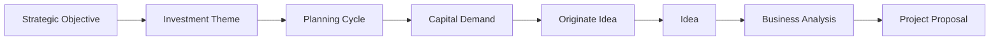
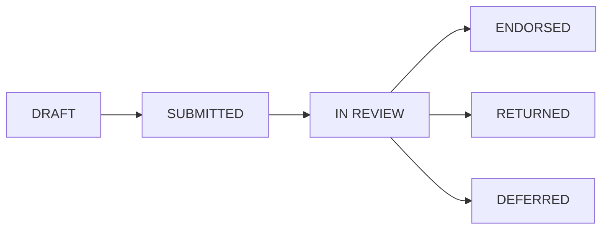
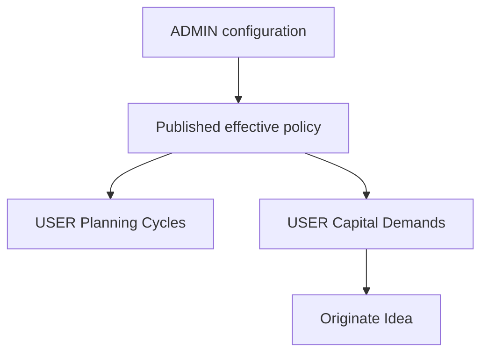

# Informe técnico Wave 1 Strategic Capital Demand and Capital Planning

## 1. Resumen ejecutivo

Wave 1 incorpora una autoridad de dominio para registrar necesidades de capital antes de que exista una solucion seleccionada. El incremento separa Strategic Capital Demand de Idea, Project, Portfolio Membership, Budget, Funding y FIN. La unica salida hacia Investment Origination es la accion explicita Originate Idea, que usa el servicio existente de Idea y conserva lineage, snapshot, hash, ETag, idempotencia y auditoria.

La implementación conserva Ideas standalone e históricas, no hace backfill y no modifica las autoridades de Business Analysis, Project Proposal, Portfolio, Budget, Funding, Economic and Financial Model ni Gate07J. Las pruebas de release y el estado exclusivo se documentan en las secciones 35 a 43. Todas las validaciones obligatorias concluyeron y el release queda declarado con el estado exclusivo consignado en la sección 43.

## 2. Baseline real del repositorio

| Evidencia | Resultado | Consecuencia |
|---|---|---|
| Rama | `main` | Se trabajo sobre la rama de integracion solicitada por el usuario. |
| Commit inicial | `9cb0969` | Punto de referencia verificable del incremento. |
| Estado inicial | Dirty preexistente | Se preservaron cambios del usuario y de incrementos anteriores. |
| Alembic inicial | `20260916_0061` | La migracion Wave 1 se encadena de forma aditiva. |
| Navegacion estrategica | `strategicNavigationBlueprint.ts` | Se conserva como fuente unica de verdad. |
| Entorno local | Frontend y API se revalidan al cierre; PostgreSQL y Chromium se verifican en entornos efímeros separados. | La disponibilidad del localhost no sustituye las pruebas obligatorias de migración, happy path y navegador real. |

La inspeccion inicial incluyo `git status`, `git diff`, `git diff --stat`, `git log -n 15` y `alembic heads`. No se limpio, descarto ni reinterpreto trabajo local existente.

El prompt fija como baseline esperado `STRATEGIC_MACROPROCESS_CPIG_GAP_REVIEW_VALIDATED`, `TARGET_STRATEGIC_ARCHITECTURE_DEFINED`, `GATE07J_EVID_2_DECISION_CRITERIA_POLICY_RELEASE_VALIDATED`, `GATE07M_BC_FIVE_CASE_RELEASE_VALIDATED`, `GATE07M_BEN_STRATEGIC_BENEFITS_RELEASE_VALIDATED` y `GATE07M_COMM_COMMERCIAL_STRATEGY_RELEASE_VALIDATED`. La sección 40 debe confirmar que Wave 1 conserva esos resultados; su enumeración aquí no sustituye la regresión.

## 3. ADR Wave 1

La decision arquitectonica se registra en `docs/70-adr-wave1-strategic-capital-demand-planning.md`. Capital Planning recibe autoridad sobre Theme, Planning Cycle y Capital Demand. Idea Demand conserva la mutacion de Idea. La operacion de origen coordina ambas autoridades dentro de una transaccion y registra una relacion inmutable.

No se incorpora Strategic Capital Buckets, Periodic Portfolio Review, Risk Appetite, Basic Data Readiness, QRA, Owner Capability Readiness ni un proveedor Gate07J.

## 4. Posicion en el proceso objetivo

Wave 1 ocupa la fase Strategic Capital Planning and Demand. Investment Origination and Shaping comienza en Idea y conserva BA and Options y Project Proposal. Esta posicion evita que una necesidad respaldada se interprete como aprobacion de solucion o de capital.

## 5. Matriz de autoridades de dominio

| Dato o accion | Autoridad | Wave 1 |
|---|---|---|
| Strategic Objectives | Enterprise Strategy | Referencia y validacion. |
| Investment Themes | Capital Planning configuration | Borrador, preview, publicacion y archivo. |
| Planning Cycles | Capital Planning USER | Creacion, apertura, revision y cierre. |
| Capital Demands | Capital Planning USER | Pipeline y lifecycle. |
| Ideas | Idea Demand | Creacion mediante la autoridad existente. |
| Options | Business Analysis | Sin duplicacion. |
| Project Proposal | Project Proposal | Sin duplicacion. |
| Portfolio Membership | Portfolio Planning | Sin side effects. |
| Budget | Portfolio Budget Planning | Sin side effects. |
| Funding | Funds Manager | Sin side effects. |
| FIN | Economic and Financial Model | Sin side effects. |

## 6. Reuse before create

Se reutilizan AdminConfiguration, AdminNumberSequence, Enterprise Workspace context, Strategic Objectives, RBAC, SecurityEvent, ETag, Idempotency Key y el servicio de Idea. La nueva autoridad evita catalogos por tabla cuando una configuracion versionada existente puede gobernarlos. Solo se crean identidades persistentes cuando el lifecycle, la concurrencia o la trazabilidad lo exigen.

## 7. Strategic Investment Theme

Theme es un catalogo ADMIN reutilizable y publicable. No es Strategic Objective, Idea Category, Strategic Capital Bucket ni Project Type. La configuracion guarda codigos, nombres, aplicabilidad y relaciones permitidas con Objectives, sin hardcodear valores productivos. La seleccion usada por una Demand queda trazada en su revision y en el snapshot de origen.

## 8. Capital Planning Cycle aggregate

CapitalPlanningCycle define codigo, nombre, inicio y fin del horizonte, Workspace, organizacion responsable, descripcion, currency context opcional, status, version, creador y timestamps. Sus estados son DRAFT, OPEN, IN_REVIEW y CLOSED. El cierre bloquea mutaciones materiales o exige una revision gobernada.

El ciclo organiza demandas; no representa Budget Planning, Budget Target ni asignacion de capital.

## 9. Strategic Capital Demand aggregate

StrategicCapitalDemand usa una identidad tecnica y un numero visible `CD-000001`. Registra Planning Cycle, Theme, Objectives, business or asset need, strategic driver, sponsor, urgency, target horizon, Workspace, location or scope, indicative capital need o range, currency, uncertainty, potential Portfolio, assumptions, constraints, dependencies, status, version y timestamps.

La configuracion efectiva define required fields y aplicabilidad. Los filtros se ejecutan en servidor y la persistencia incorpora indices para el acceso por tenant, scope, cycle, status y clasificaciones estrategicas.

## 10. Demand lifecycle

Las transiciones controladas incluyen return, defer, cancel y supersede cuando corresponden. ENDORSED confirma que la necesidad puede entrar en investment origination; no aprueba una solucion, Project, Portfolio, Budget, Funding ni FID.

## 11. Lineage Objective Theme Cycle Demand

La lineage se mantiene por referencias estables y snapshots. Objectives siguen bajo Enterprise Strategy; Themes expresan clasificacion; Cycle expresa periodo; Demand expresa necesidad. Ninguna capa copia la autoridad de la anterior.

## 12. Contrato Demand to Idea

Originate Idea recibe Capital Demand ID, If Match, Idempotency Key y campos iniciales permitidos para Idea. Valida estado y policy, congela el snapshot y usa la autoridad Idea Demand. Devuelve Idea ID, Idea number, source Capital Demand ID, source snapshot hash y un indicador created o existing.

La operacion no crea Project, Proposal, Portfolio Membership, Budget ni Funding.

## 13. One Demand to many Ideas

La cardinalidad es una Demand a cero o muchas Ideas. Cada nuevo intento de negocio usa una clave idempotente distinta y crea una relacion de origen independiente. La repeticion de la misma clave devuelve la relacion existente. La unicidad se aplica a la clave de intento y al par de lineage requerido, no a Demand ID por si solo.

## 14. Compatibilidad con standalone Idea

Ideas historicas y las Ideas directas permitidas por policy conservan `source_capital_demand_id = null`. CAPITAL_OWNER puede exigir origen para nuevos programas; CONTRACTOR_DELIVERY y DIRECT_INTERNAL no se fuerzan por defecto; LEGACY_UNCLASSIFIED mantiene compatibilidad.

## 15. Snapshot de origen de Idea

El snapshot contiene Demand ID, version, numero, nombre, need, driver, Theme, Objectives, Cycle, sponsor, horizonte, capital indicativo, currency, uncertainty, Workspace y potential Portfolio. La serializacion canonica produce un hash determinista. El snapshot queda inmutable aunque la Demand tenga una revision posterior.

## 16. Compatibilidad historica

La migracion es aditiva y no ejecuta backfill. Las consultas previas de Idea, BA y Proposal aceptan lineage nula. No se reinterpretan estados, decisiones, hashes ni configuraciones publicadas de incrementos anteriores.

## 17. Configuracion ADMIN

ADMIN configura Themes, drivers, categories, horizons, required fields, lifecycle, applicability, Project Type rules, Governance Model rules, uncertainty scale, numbering, inheritance, SoD y review policy. La configuracion usa DRAFT, PUBLISHED y ARCHIVED. Preview devuelve `persisted=false`. Clone, publish y archive siguen los patrones actuales.

ADMIN no crea ni modifica Planning Cycles o live Demands.

## 18. Flujo USER

USER consulta Planning Cycles y Capital Demand Pipeline; crea y edita demandas; submit, start review, return, endorse, defer o cancel segun permisos; consulta historia y origina Ideas. La pantalla distingue el capital indicativo de Budget y Funding y muestra las Ideas originadas.

## 19. Matriz ADMIN USER

| Capacidad | ADMIN | USER |
|---|---|---|
| Theme catalog | Configura y publica | Lee configuracion efectiva. |
| Required fields and lifecycle | Configura y publica | Aplica. |
| Planning Cycle | No opera registros vivos | Crea y gobierna. |
| Capital Demand | No opera registros vivos | Crea y transiciona. |
| Originate Idea | No por permiso de config | Ejecuta con permiso transaccional. |
| Preview | Persisted false | No disponible. |

## 20. Governance Model applicability

CAPITAL_OWNER es el modelo objetivo por defecto. CONTRACTOR_DELIVERY no entra forzosamente por Capital Planning. DIRECT_INTERNAL puede conservar Idea directa. LEGACY_UNCLASSIFIED mantiene la compatibilidad historica. Las reglas se resuelven desde configuracion efectiva y no desde condiciones hardcoded en UI.

## 21. Project Type applicability

Project Type es una dimension de tailoring y no reemplaza Governance Model. La configuracion puede definir required fields o permitir origen directo por tipo, pero una Demand no crea Project ni selecciona un Project Type definitivo.

## 22. Uncertainty handling

Uncertainty es una dimension gobernada y contextual. Puede clasificar el nivel de informacion disponible, pero no calcula riesgo ni QRA. Su escala proviene de configuracion y queda incluida en el snapshot de origen.

## 23. Semantica de capital indicativo

Todo valor en Demand significa Indicative Capital Need. La UI y la API no lo etiquetan como Approved Budget, Budget Allocation, Approved CAPEX, Funding Assignment, Cash Flow o FIN model. ENDORSED no cambia esa semantica.

## 24. Comportamiento multi currency

Los resumenes agrupan montos por currency. Cuando existen varias monedas y no hay normalizacion gobernada, la API no entrega un total consolidado silencioso y la UI muestra una advertencia explicita. No se inventan tasas de conversion.

## 25. Numbering

AdminNumberSequence genera numeros de Demand y Cycle segun reglas publicadas. La asignacion ocurre dentro de la transaccion de creacion y es segura frente a concurrencia. El formato visible no sustituye la primary key.

## 26. Roles and permissions

| Permission | Proposito |
|---|---|
| `capital_planning.read` | Leer ciclos, pipeline, Demand e historia. |
| `capital_planning.cycle.create` | Crear Planning Cycle. |
| `capital_planning.demand.create` | Crear Demand. |
| `capital_planning.demand.edit` | Editar una revision mutable. |
| `capital_planning.demand.submit` | Someter. |
| `capital_planning.demand.review` | Revisar y devolver. |
| `capital_planning.demand.endorse` | Respaldar. |
| `capital_planning.idea.originate` | Originar Idea. |
| `capital_planning.admin.configure` | Editar configuracion draft. |
| `capital_planning.admin.publish` | Publicar configuracion. |

La API aplica estos permisos tambien en acceso directo por URL.

## 27. Separation of duties

Cuando la policy exige SoD, el autor no puede ejecutar el endorsement final. El actor de configuracion no recibe por implicacion permisos USER. La violacion devuelve un error gobernado y genera evidencia sin mutar el estado.

## 28. ETag

Las mutaciones reciben If Match y comparan revision version. Un valor obsoleto devuelve HTTP 412 con codigo `ETAG_MISMATCH`, version esperada y version actual. La respuesta expone el nuevo ETag despues de cada mutacion correcta.

## 29. Idempotency

Create Cycle, create Demand, endorse Demand y Originate Idea registran Idempotency Key con una restriccion de unicidad adecuada al tenant y operacion. La repeticion devuelve el resultado original. Originate Idea confirma que no se crea una segunda Idea con la misma clave, incluso ante retries concurrentes.

## 30. SecurityEvent

Las creaciones, transiciones, publicaciones y origen de Idea generan SecurityEvent con actor, tenant, target type, target ID, action, timestamp y detalle de version. Los eventos no contienen secretos ni sustituyen el snapshot de negocio.

## 31. Diseño de persistencia

La persistencia incorpora CapitalPlanningCycle, StrategicCapitalDemand y CapitalDemandIdeaOrigin. Theme reutiliza la configuracion versionada. Las relaciones de Objective y Theme se almacenan con una estrategia consultable e indexada para evitar escaneos completos y N plus one. Los hashes usan serializacion canonica.

## 32. Migración

La revisión `20260929_0062` desciende de `20260916_0061`, conserva una sola cabeza y agrega estructuras Wave 1 sin backfill. El downgrade elimina solo los objetos nuevos o columnas nullable de lineage. La prueba de migración usa una base PostgreSQL desechable y ejecuta up, down y up. El resultado ejecutado se consigna en la sección 35; esta descripción de diseño no equivale por sí sola a evidencia de reversibilidad.

## 33. API

La API expone operaciones USER para listar, crear, leer y actualizar ciclos y demandas; ejecutar transiciones; originar Idea; consultar originadas e historia. ADMIN expone listado, effective preview, clone, draft update, publish y archive. Los listados usan paginacion estable, filtros de servidor y lecturas batch.

## 34. Integración de navegación

La fase 1 USER se presenta como Strategic Capital Planning and Demand. Planning Cycles y Demand Pipeline aparecen antes de Investment Origination and Shaping. Los IDs y bookmarks previos de Idea, BA y Proposal siguen resolviendo. ADMIN presenta Strategic Capital Planning and Demand Configuration sin transacciones USER. `App.tsx` permanece sin expansion del nuevo dominio.

## 35. PostgreSQL happy path

La prueba de release usa una base efimera CAPITAL_OWNER y recorre publicacion de config, Cycle, Demand, Objectives, Theme, need, driver, sponsor, horizon, indicative capital, submit, independent review, endorse y Originate Idea. Luego repite la misma Idempotency Key y verifica una sola Idea y una sola relacion de origen.

**Evidencia ejecutada:** el perfil `validation` de `docker-compose.wave1.yml` levantó dos PostgreSQL 16 desechables y ejecutó `pytest --no-cov -q -rA tests/postgres/test_wave1_capital_planning_migration_postgres.py` y `pytest --no-cov -q -rA tests/postgres/test_wave1_capital_planning_release_postgres.py`. La migración `up → down → up` terminó con 1 prueba aprobada en 24,63 s. El release PostgreSQL terminó con 2 pruebas aprobadas en 37,11 s.

El happy path verificó `CAPITAL_OWNER`, configuración publicada, Cycle, Demand, Objectives, Theme, sponsor, capital indicativo, revisión independiente, endorsement, snapshot/hash y multi currency. El caso concurrente con la misma Idempotency Key preservó exactamente una Idea y una relación de origen; una clave diferente permitió una segunda Idea.

**Resultado de validación:** PASS.

## 36. Pruebas negativas y de regresion

La suite cubre: endorsement sin Idea automatica; una Demand con multiples Ideas; Idea standalone con lineage nula; no Project, Membership, Budget o Funding side effects; no suma silenciosa multi currency; separacion ADMIN and USER; ETag 412; SoD; idempotencia y compatibilidad Idea, BA y Proposal.

**Evidencia ejecutada:** la suite local Wave 1, incluida la prueba HTTP directa USER/ADMIN, terminó con 6 pruebas aprobadas en 79,24 s. La regresión histórica de Idea Lifecycle, Business Analysis y Project Proposal terminó con 19 pruebas aprobadas en 154,27 s. Los asserts confirmaron lineage nullable para Idea histórica, relación 1:N, ETag 412, SoD, filtros, multi currency y ausencia de creación de Project, Portfolio Membership, Budget o Funding.

**Resultado de validación:** PASS.

## 37. Browser USER E2E

Chromium recorre USER MODE, Planning Cycles, Demand Pipeline, create and edit, submit, review, endorse, Originate Idea, open originated Idea e historia. Confirma que no aparecen controles ADMIN.

**Evidencia ejecutada:** PostgreSQL 16, Redis, API, frontend y Chromium se levantaron con el perfil `browser`. `docker compose ... run --rm --no-deps wave1-browser-e2e` ejecutó los dos escenarios del archivo `e2e/capital-planning.spec.ts`; ambos terminaron aprobados en 2,6 min. El escenario USER creó y abrió Cycle, creó y editó Demand, recorrió submit, independent review y endorse, cambió a Endorsed Demands, originó la Idea explícitamente, verificó el hash SHA-256, lineage e historia y abrió Idea Lifecycle. También confirmó la ausencia de acciones ADMIN.

La prueba descubrió y cerró dos defectos de navegador: UUID en origen HTTP no seguro y recarga inmediata de `Originated Ideas` cuando la Demand seleccionada conserva el mismo ID. Ambos quedaron cubiertos por 8 pruebas frontend focalizadas.

**Resultado de validación:** PASS.

## 38. Browser ADMIN E2E

Chromium recorre ADMIN MODE, Themes, drivers, horizons, applicability, required fields, lifecycle, numbering, inheritance, SoD, preview, clone, publish y archive. Confirma que no aparecen transacciones live de Demand.

**Evidencia ejecutada:** el segundo escenario Chromium, dentro del mismo resultado 2/2 aprobado, abrió ADMIN MODE y verificó las 14 secciones gobernadas, preview `persisted=false`, workspace context, política que impide archivar el default sin reemplazo, clone a DRAFT, edición estructurada, publicación e herencia efectiva. No expuso creación de Cycle, Demand, endorsement ni origen de Idea.

**Resultado de validación:** PASS.

## 39. Observación de rendimiento

El diseño usa paginación y filtros de servidor. Las relaciones se cargan en batch y los índices cubren tenant, scope, cycle, state, Theme, Objective, sponsor, Workspace, urgency, horizon, potential Portfolio y uncertainty. Las métricas multi currency se agrupan por currency.

**Evidencia ejecutada:** se inspeccionaron los listados `page/page_size`, filtros de servidor y la lectura batch de relaciones de origen, eliminando la lectura por fila que producía N plus one. Las pruebas ejercitaron filtros de estado, Theme, Objective, driver, sponsor, Workspace, urgency, horizon, potential Portfolio, uncertainty y `mine`; los totales multi currency permanecieron separados.

El conjunto observado fue deliberadamente pequeño y determinista —un Cycle, una Demand y hasta dos Ideas en los casos centrales—. Esta evidencia valida forma de consulta, índices y límites funcionales; no constituye benchmark ni permite proyectar latencia o throughput de producción.

**Resultado de validación:** PASS con limitación de volumen documentada.

## 40. Regresión estratégica completa

La validacion ejecuta tests enfocados de Wave 1, suites de Idea, Business Analysis, Project Proposal, navegacion, type checking, build, lint y format. Gate07J provider registry y policy hashes se comparan para confirmar que no cambiaron.

**Evidencia ejecutada:** `python scripts/validate_wave1_release_guardrails.py` devolvió `WAVE1_RELEASE_GUARDRAILS=PASS`; `alembic heads` devolvió únicamente `20260929_0062 (head)`. `tsc`, el build de Vite y Prettier terminaron con código 0. ESLint terminó con 0 errores y 9 warnings preexistentes, todos ubicados en `BimIfcModelViewer.tsx`. La suite focalizada final de Capital Planning aprobó 8/8 pruebas. La suite frontend integral concluyó con 60 archivos y 284/284 pruebas aprobadas en 896,03 segundos.

Los hashes SHA-256 de las fronteras no modificadas son: `App.tsx` = `8A1692D5ADB7C8FEFCED6DAA7BB63CE65F6FA5DAF31AB064DA2520020EAD8879`; Gate07J evidence service = `96D2B6223D3C95DB0FA432ED2098B8D1FA103FF1A48BF2F88B0BDDB27A1D9B13`; decision criteria = `FCE26263FD7B4D6980AC9A980CA7E6D4E1083F188F0E837BA60E67DEB7197840`; gate preparation = `910D021334063A8B1B26F083F4A8BBD0A3259514585C3785B7D270E12E01D208`.

**Resultado de validación:** PASS.

## 41. Deuda técnica

La automatización PostgreSQL de Wave 1 queda integrada en `.github/workflows/ci.yml` mediante el perfil efímero `validation` de `docker-compose.wave1.yml`; el smoke Playwright general incluye la especificación de Capital Planning y el perfil `browser` permite su reproducción aislada. La deuda candidata se limita a observabilidad de volumen real y benchmark con datos de producción anonimizados. Ninguna deuda puede ocultar un criterio funcional obligatorio.

## 42. Análisis final de brechas

Wave 1 cierra Strategic Capital Demand and Capital Planning Foundation. Permanecen, por decisión de alcance, Strategic Capital Buckets, Bucket Allocation Plan, Periodic Portfolio Review, Risk Appetite, Basic Data Readiness, QRA or Confidence y Owner Capability Readiness. Gate07J no recibe un provider ni cambios de policy de Capital Planning.

También permanecen fuera de alcance Project Creation, Portfolio Membership, Budget allocation, Funding, Procurement execution, Project Delivery, Operational Readiness y Benefits Realization. El cierre debe verificar que Wave 1 no introdujo efectos laterales en esas autoridades.

## 43. Estado final de release

El estado exclusivo se asigna solo cuando todas las pruebas obligatorias quedan verificadas. La matriz de cierre consolida los criterios del prompt y los límites STOP sin convertir futuras capacidades en parte de Wave 1.

| Criterio de aceptación | Estado | Evidencia de cierre |
|---|---|---|
| Strategic Capital Planning foundation, Themes, Cycle y Demand con identidad estable | PASS | Dominio, configuración versionada, API, migración y pruebas Wave 1. |
| Demand distinta de Idea, Project, Budget, Funding y FIN | PASS | Fronteras de autoridad y pruebas negativas sin efectos laterales. |
| Objective → Theme → Cycle → Demand | PASS | Relaciones persistidas y trazabilidad consultable en API y UI. |
| Demand → Idea explícito, idempotente y 1:N | PASS | Servicio de Idea reutilizado, snapshot/hash congelado y reintento sin duplicado. |
| Endorsement sin creación automática de Idea | PASS | Prueba negativa local y PostgreSQL. |
| Ideas existentes y standalone válidas; sin backfill | PASS | Regresión histórica Idea/BA/Proposal aprobada y origen nullable. |
| Sin creación automática de Project o Portfolio Membership | PASS | Pruebas de ausencia de efectos laterales. |
| Sin cambios de Budget o Funding | PASS | Autoridades excluidas y pruebas negativas. |
| Capital indicativo y multi currency sin suma silenciosa | PASS | Etiquetado explícito y agrupación por currency. |
| ADMIN solo configuración; USER solo registros vivos | PASS | Permisos, rutas directas y E2E de ambos modos. |

<!-- PAGE_BREAK -->

| Criterio de aceptación (continuación) | Estado | Evidencia de cierre |
|---|---|---|
| SoD, ETag, idempotencia y SecurityEvent | PASS | Casos de autor/endorser, 412, claves repetidas y auditoría. |
| Snapshots e hashes históricos deterministas | PASS | Origen inmutable y control de revisiones. |
| Migración aditiva, reversible y con una sola cabeza | PASS | PostgreSQL up/down/up y `20260929_0062 (head)`. |
| Navegación canónica, compatibilidad de rutas y App.tsx sin expansión estructural | PASS | Blueprint reutilizado, pruebas de navegación y guardrail hash. |
| Happy path PostgreSQL | PASS | Config → Cycle → Demand → review → endorse → Idea → retry. |
| Chromium USER y ADMIN reales | PASS | Dos escenarios aprobados en el perfil Docker browser. |
| Governance Model e histórico Idea/BA/Proposal | PASS | Regresión backend aprobada. |
| Sin Buckets, Portfolio Review, Gate07J provider/policy, Basic Data, QRA ni Owner Capability | PASS | Guardrails, hashes y revisión de alcance. |
| Sin Project Creation, Budget allocation, Funding, Procurement, Delivery, Operational Readiness ni Benefits Realization | PASS | Límites STOP y pruebas de no efectos laterales. |
| Regresión frontend integral | PASS | 60 archivos y 284/284 pruebas aprobadas. |

**Estado final:** STRATEGIC_CAPITAL_DEMAND_AND_CAPITAL_PLANNING_FOUNDATION_RELEASE_VALIDATED.

**Final output:** READY_FOR_GOVERNED_STRATEGIC_CAPITAL_DEMAND_PIPELINE.

## 44. Recomendación del siguiente incremento

Tras un release exitoso, Wave 2A Strategic Capital Buckets tiene dependencia directa de Planning Cycles y Capital Demands y prepara la asignación estratégica antes del Periodic Portfolio Review. Wave 2B Risk Appetite and Basic Data Readiness es una rama paralela útil, pero amplía el alcance de datos y riesgo sin cerrar primero la agrupación de capital habilitada por Wave 1.

**Única recomendación:** Wave 2A Strategic Capital Buckets. No se implementa Wave 2A ni Wave 2B como parte de este cierre.
