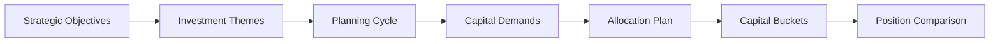
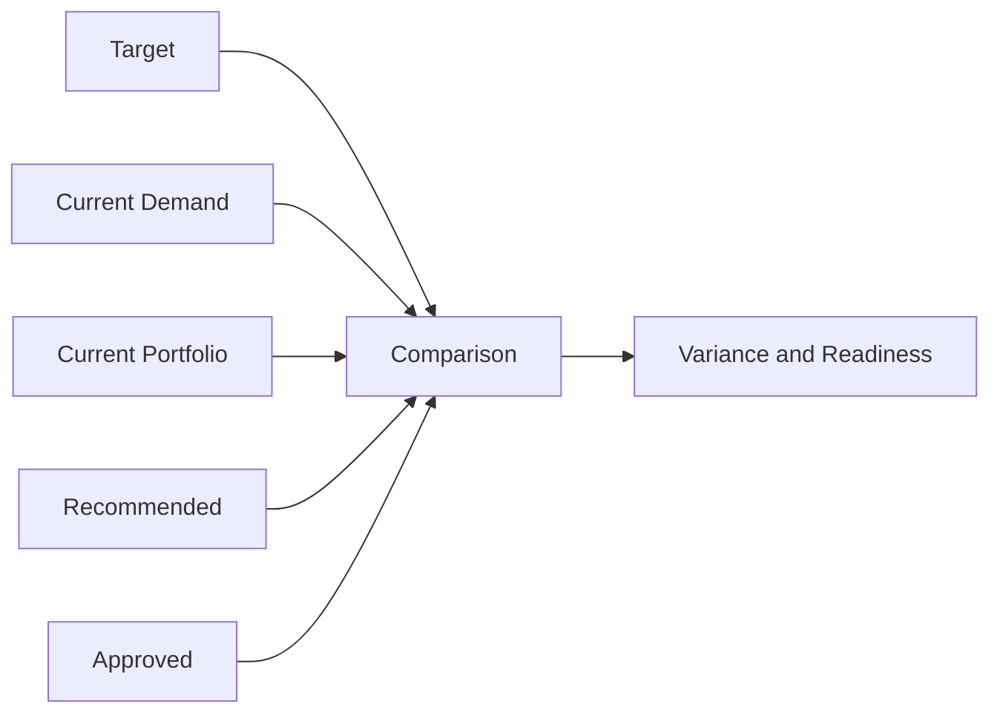
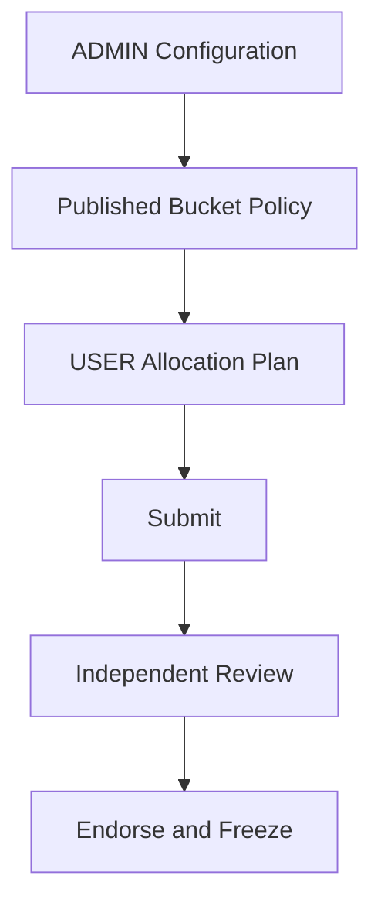

# Informe técnico fuente — Wave 2A Strategic Capital Buckets and Allocation Framework

**Estado final:** STRATEGIC_CAPITAL_BUCKETS_AND_ALLOCATION_FRAMEWORK_RELEASE_VALIDATED

## 1. Resumen ejecutivo

Wave 2A extiende Capital Planning con un catálogo versionado de Strategic Capital Buckets y Allocation Plans live ligados a Planning Cycles. El diseño separa target estratégico, current demand, current portfolio, recommended y approved position. Bucket no es Theme, Objective, Project Rank, Budget, Funding, Resource Scenario ni FID.

La implementación reutiliza Wave 1, Portfolio Membership, Evaluation/Rank, Budget/Resource Scenarios, Gate07I, Gate07K, AdminConfiguration, AdminNumberSequence, RBAC, SecurityEvent, ETag, idempotencia, navegación estratégica y guardrails multi-currency. Las evidencias obligatorias de las secciones 47 a 63 quedaron ejecutadas y consolidadas.

## 2. Baseline real del repositorio

| Evidencia | Resultado observado al inicio | Interpretación |
|---|---|---|
| Rama | `main` | Rama de integración actual. |
| Commit | `9cb0969` | Punto de referencia del inicio de Wave 2A. |
| Estado | Dirty preexistente | Se preserva trabajo del usuario y de incrementos anteriores. |
| Alembic head | `20260929_0062 (head)` | Baseline Wave 1 confirmado con `alembic heads`. |
| Wave 1 | `STRATEGIC_CAPITAL_DEMAND_AND_CAPITAL_PLANNING_FOUNDATION_RELEASE_VALIDATED` | Dependencia funcional disponible. |
| Navegación | `strategicNavigationBlueprint.ts` | Fuente única de verdad a extender. |

La inspección inicial incluye `git status`, `git diff`, `git diff --stat`, `git log -n 15` y `alembic heads`. No se limpia, resetea, descarta ni reescribe trabajo local.

## 3. ADR Wave 2A

La decisión se registra en `docs/72-adr-wave2a-strategic-capital-buckets-allocation.md`. Capital Planning recibe autoridad sobre Bucket definition, applicability, Allocation Plan, target allocation, min/max, clasificación contextual, variance y comparison. Las fuentes Portfolio/Gate permanecen read-only.

## 4. Posición en el proceso objetivo

```text
Strategic Objectives
  -> Strategic Investment Themes
  -> Capital Planning Cycle
  -> Strategic Capital Demands
  -> Strategic Capital Allocation Plan
  -> Strategic Capital Buckets
  -> Target allocation
  -> Current / Recommended / Approved comparison
```

La salida explícita Demand → Idea continúa separada. Bucket logic no se coloca dentro de Idea.



## 5. Matriz de autoridad de dominio

| Autoridad | Produce | Wave 2A consume | Wave 2A muta |
|---|---|---|---|
| Enterprise Strategy | Strategic Objectives | Sí | No |
| Capital Planning Wave 1 | Themes, Cycles, Demands | Sí | Solo cross-classification gobernada |
| Capital Planning Wave 2A ADMIN | Bucket catalog/policy | Sí | Sí, configuración versionada |
| Capital Planning Wave 2A USER | Allocation Plan/targets/classification | Sí | Sí, lifecycle propio |
| Portfolio Planning | Membership | Sí | No |
| Portfolio Evaluation | Score/Rank | Sí | No |
| Portfolio Budget | Budget Scenario | Sí, read-only | No |
| Portfolio Resource | Resource Scenario | Sí, read-only | No |
| Gate07I | Recommendation | Sí, read-only | No |
| Gate07K | InvestmentDecision/FID semantics | Sí, read-only | No |
| Funds / FIN | Funding/model | No | No |

## 6. REUSE BEFORE CREATE

| Activo | Reuso esperado | Prohibición de duplicación |
|---|---|---|
| Planning Cycle | Contexto obligatorio del plan | No segundo calendario |
| Strategic Capital Demand | Current demand y cobertura | No segundo pipeline |
| Theme configuration | Mapping/suggestion | No segundo Theme catalog |
| Strategic Objective | Referencia/alineación | No copia ni re-score |
| Portfolio Membership | Current portfolio | No segundo membership |
| Evaluation/Rank | Contexto read-only | No score/rank nuevo |
| Budget Scenario | Posición read-only | No target/scenario nuevo |
| Resource Scenario | Posición read-only | No capacity/scenario nuevo |
| Gate07I | Recommended source | No reselección |
| Gate07K | Approved source | No decisión/FID nuevo |
| AdminConfiguration | Bucket catalog/policy | No tabla de catálogo innecesaria |
| AdminNumberSequence | Número de plan | No generador paralelo |
| RBAC/SecurityEvent/ETag/Idempotency | Controles transversales | No motor paralelo |
| Blueprint/currency guardrails | Navegación y no-silent-FX | No routing monolítico/no FX inventada |

## 7. Concepto Strategic Capital Bucket

Bucket es una categoría estratégica reusable de agrupación y allocation intent. Sus valores productivos son ADMIN-configured. Code, name, purpose, applicability, effective dates y display order viven en configuración versionada. Un Bucket usado se archiva y sigue legible en snapshots históricos.

## 8. Theme versus Bucket

Theme expresa qué naturaleza estratégica persigue la necesidad. Bucket expresa cómo se agrupa capacidad de capital. La relación puede permitir uno, varios o ningún default. Un mapping genera suggestion, no asignación final opaca.

## 9. Strategic Objective versus Bucket

Objective sigue bajo Enterprise Strategy. Bucket puede referenciar Objectives para alineación, pero no los crea, edita, puntúa ni reasigna.

## 10. Bucket configuration

ADMIN configura catálogo, propósito, Theme/Objectives mappings, allocation basis, min/target/max semantics, tolerancias, clasificación, `UNCLASSIFIED`, status eligibility, Cycle/Portfolio/Governance Model/Project Type applicability, herencia, numeración, review/SoD, preview, history, clone, publish y archive. Preview debe devolver `persisted=false`.

## 11. Allocation Plan aggregate

El agregado conserva identidad estable, número visible, Cycle, scope, Workspace, Portfolio opcional, base currency opcional, basis, status, version, configuración/hashes, actor y timestamps. Sus líneas representan Buckets, nunca Projects individuales.

## 12. Allocation Plan lifecycle

`DRAFT -> IN_REVIEW -> ENDORSED`, con `RETURNED`, `SUPERSEDED` y `CANCELLED` según policy. Endorsed es inmutable; cambios materiales producen una revisión sucesora DRAFT.

## 13. Allocation basis

La configuración permite `PERCENTAGE`, `INDICATIVE_AMOUNT` o `PERCENTAGE_AND_AMOUNT`. Un amount es planning envelope/target; nunca Approved Budget, executable CAPEX ni Funding.

## 14. Bucket Allocation Line

Cada línea contiene Bucket code, target/min/max percentage o amount, currency, rationale, Objective links, assumptions, constraints y priority note opcional. No contiene Project IDs.

## 15. Min/Target/Max semantics

Los rangos son guías estratégicas y alimentan variance/status. No son hard limits de Budget, Funding o contract commitment.

## 16. Percentage validation

El backend aplica la regla publicada: 100 %, reserva explícita o horizonte parcial. No normaliza silenciosamente. La prueba negativa debe demostrar rechazo de un total inválido.

## 17. Demand classification

Una Demand elegible tiene como máximo un primary Bucket por contexto efectivo. La clasificación puede ser manual, default derivado o suggestion, siempre con source y rationale. No muta Idea, BA, Proposal, Project o Membership.

## 18. Project/Portfolio classification

Projects standalone usan cross-classification explícita de Project Workspace o Portfolio Membership cuando no existe lineage. Bucket no forma parte de la identidad de `EnterpriseWorkspace`.

## 19. Classification precedence

El backend aplica: explicit Project/Portfolio classification → source Demand classification → Theme default → `UNCLASSIFIED`. Browser no resuelve precedencia.

## 20. Unclassified policy

`UNCLASSIFIED` permanece visible y en el denominador. Coverage insuficiente bloquea endorsement o genera warning según policy; nunca se descarta capital silenciosamente.

## 21. Current Demand Position

Se deriva de Demands en statuses configurados, primary classification, Indicative Capital Need y currency. Budget Scenario no es fuente de esta posición.

## 22. Current Portfolio Position

Se deriva read-only de Portfolio Membership, origin lineage y cross-classification. No crea ni cambia membership.

## 23. Recommended Scenario Position

Se deriva de Gate07I/recommendation y escenarios seleccionados cuando existe información resoluble. No altera selección, scenario ni recommendation. Datos incompatibles producen `NOT_EVALUABLE`.

## 24. Approved Investment Position

Se deriva solo de decisiones que representan capital autorizado. `PYP-INV-SELECT + GO` no equivale a full approved capital. `PYP-FFA + GO` reutiliza `is_fid`, `full_funds_authorized` e `investment_authorized`.

## 25. Modelo Target/Current/Recommended/Approved

`TARGET` proviene del plan; `CURRENT_DEMAND` del pipeline; `CURRENT_PORTFOLIO` de membership; `RECOMMENDED` de Gate07I; `APPROVED` de Gate07K. La API conserva labels y lineage diferenciados.



## 26. Variance model

Por Bucket se muestra target, current demand, current portfolio, recommended, approved y variance contra target, en porcentaje y amount cuando son evaluables. Status derivado: under, within, over, unclassified exposure o not evaluable.

## 27. Multi-currency behavior

Sin FX gobernada, los montos se agrupan por currency y no se calcula un total o porcentaje falso. La UI expone la limitación.

## 28. No-double-counting controls

La unicidad contextual de primary Bucket y la resolución backend aseguran que una misma Demand/Project amount no se agrega dos veces. Analytical tags opcionales no alimentan totales primarios.

## 29. Strategic alignment

La policy valida Bucket ↔ Theme, Bucket ↔ Objective y Demand ↔ Bucket. No modifica Objectives ni crea un score estratégico paralelo.

## 30. Planning Cycle integration

El plan referencia un Cycle existente, horizonte compatible y comportamiento de ciclo cerrado. La policy limita un current plan no ambiguo por Cycle/scope; historia se conserva por revisiones.

## 31. Historical snapshots

Endorsed congela plan, líneas, Bucket definitions, configuración/hash, Cycle, scope, assumptions, classification policy y source context. El snapshot no se recalcula.

## 32. Source-current y staleness

Un cambio material de configuración no altera un endorsed plan; puede marcar la comparación live como `STALE` y requerir una nueva revisión.

## 33. Refresh Preview / Apply

El preview reutilizable de configuración está disponible mediante el flujo ADMIN y debe devolver `persisted=false`. El agregado live ya dispone de creación de revisión sucesora DRAFT, pero en esta entrega no se declara un endpoint específico `Refresh Preview / Apply` del Allocation Plan. Esta capacidad opcional queda diferenciada de la inmutabilidad obligatoria del plan endorsed y no se simula como validada.

## 34. ADMIN configuration

La navegación objetivo es Enterprise Strategy Manager → Strategic Capital Planning & Demand Configuration → Strategic Capital Buckets. No incluye acciones live del Allocation Plan.

## 35. USER workflow

La navegación objetivo es Strategic Capital Planning & Demand → Strategic Capital Allocation / Allocation History. Views: overview, target, demand, portfolio, recommended, approved, variance, classification, readiness e history. **Pruebas frontend locales:** PASS, 3 archivos y 13 casos Vitest (5 API, 5 workspace y 3 navegación); cubren normalización API, ETag/idempotency de clasificación, currencies separadas, exposición unclassified, History, edición exacta de target, creación con scope explícito, acciones de lifecycle gobernadas y proyección ADMIN/USER.

## 36. Matriz ADMIN / USER

| Capacidad | ADMIN | USER |
|---|---|---|
| Bucket catalog/policy | Configura/publica/archiva | Consume efectiva |
| Live Allocation Plan | No edita | Crea/revisa/endorse según permisos |
| Classification policy | Configura | Aplica |
| Demand/Project classification | No opera live | Clasifica según permiso |
| Preview reusable config | Sí, `persisted=false` | No |
| Comparison/history | Política y definición | Lectura live/histórica |



## 37. Roles y permisos

Se extiende el catálogo de Capital Planning con permisos allocation read/create/edit/submit/review/endorse, bucket classify y admin bucket configure/publish. La API los aplica en direct route.

## 38. Separation of duties

Cuando está configurado, author ≠ final endorser. Publicar configuración no concede permisos transactionales USER.

## 39. ETag

Las mutaciones reciben `If-Match`; stale version devuelve `412 ETAG_MISMATCH` sin persistir cambios.

## 40. Idempotency

Create Plan, new revision, endorse y classify usan `Idempotency-Key`. Repetir key y payload devuelve el resultado original; un conflicto no crea duplicados.

## 41. SecurityEvent

Configuración, lifecycle, clasificación y revision generan eventos tenant-aware con actor, target, acción, versión y outcome.

## 42. Persistence design

El catálogo Bucket reutiliza `AdminConfiguration`. Planes, líneas/revisiones y cross-classifications solo se normalizan donde identidad, FK, uniqueness, indexación o inmutabilidad lo exigen. Snapshot JSON/hash preserva historia.

## 43. Migration

La migración inspeccionada es `20261001_0063_wave2a_strategic_capital_allocation.py`, sucesora única de `20260929_0062`. El guardrail estático confirma que el `upgrade` es aditivo, que no altera tablas de autoridades Portfolio/Gate y que mantiene el STOP boundary. **SQLite up/down/up:** PASS. **PostgreSQL 16 up/down/up en Docker efímero:** PASS, 1 prueba en 23,36 s. La validación comprobó las cuatro tablas Wave 2A, nulabilidad, índices/uniqueness, conservación de la superficie 0062 y restauración correcta tras `down` y segundo `up`.

## 44. API

USER: list/create/read/update, lifecycle, new revision, comparison, variance, classification e history. ADMIN: configurations, effective preview, clone, draft update, publish y archive. Listados paginados y filtrados en servidor.

## 45. Comparison read model

Una operación backend agrega target/current demand/current portfolio/recommended/approved/variance por Bucket. La UI no ejecuta N+1 ni calcula precedencia o autoridad.

## 46. Navigation

La fuente es `strategicNavigationBlueprint.ts`; el outlet registra los renderers USER de Allocation e History y el renderer ADMIN de Bucket configuration. Se preservan rutas históricas. `App.tsx` no incorpora tokens, imports, branches ni routing Wave 2A. **Guardrail estático:** PASS.

## 47. PostgreSQL happy path

Flujo obligatorio: CAPITAL_OWNER → publish Bucket config → Cycle → create Plan → al menos cuatro Buckets → targets → classify Demands → derive positions → variance → submit → independent review → endorse → freeze snapshot/hash. Debe comprobar cero mutaciones de Rank, Budget, Resource, Gate07I y Gate07K. **Resultado PostgreSQL 16 en Docker efímero:** PASS, 2 pruebas en 39,05 s. La evidencia cubre schema/constraints y el happy path gobernado con cuatro Buckets, dos monedas, cobertura de clasificación de 50 % a 100 %, no doble conteo, source hash, SoD de review/endorsement, snapshot/hash inmutable, SecurityEvent y conteos sin side effects sobre autoridades vecinas.

## 48. Percentage negative test

Total no permitido por policy produce `422 INVALID_TARGET_PERCENTAGE_TOTAL` sin persistir líneas normalizadas. La misma prueba confirma `412 ETAG_MISMATCH` para una versión obsoleta. **Resultado:** PASS.

## 49. Unclassified coverage test

Coverage por debajo de policy permanece visible en el denominador: la prueba pasa de 50 % a 100 % y bloquea el submit con `409 UNCLASSIFIED_COVERAGE_EXCEEDS_POLICY` mientras la policy no se cumple. **Resultado:** PASS.

## 50. Multi-currency test

Demands COP y USD permanecen agrupadas por moneda, activan `multi_currency`, publican `normalization_warning` y producen posiciones no evaluables donde no existe normalización gobernada. El navegador confirma la advertencia sin total silencioso. **Resultado:** PASS.

## 51. Standalone Project classification test

Project sin Demand debe resolver explicit cross-classification o `UNCLASSIFIED`. La prueba focal crea Project y Portfolio Membership standalone, verifica precedencia de las clasificaciones explícitas `PROJECT` y `PORTFOLIO_MEMBERSHIP`, y conserva otro Project standalone como `UNCLASSIFIED` sin excluirlo de la posición. **Resultado:** PASS.

## 52. Lineage classification test

Project con source Demand debe resolver el primary Bucket de Demand salvo explicit override de mayor precedencia. La prueba focal recorre Demand → Idea → Project → Portfolio Membership y resuelve `SOURCE_CAPITAL_DEMAND:THEME_TO_BUCKET_DEFAULT`; además comprueba que las clasificaciones explícitas de Project/Membership mantienen mayor precedencia. **Resultado:** PASS.

## 53. No-double-counting test

Un source amount no puede agregarse en dos primary Buckets. La prueba PostgreSQL clasificó dos Demands en dos primary Buckets y verificó que la suma de `item_count` permaneciera exactamente en dos; la prueba focal Project/Membership/lineage confirma una sola resolución efectiva por fuente y autoridades vecinas intactas. **Resultado:** PASS.

## 54. Portfolio Rank regression

Hashes/filas/ranks antes y después del happy path deben coincidir. La prueba focal Wave 2A conserva los conteos de autoridad y la regresión estratégica 07E/07G/07G-A/07H/07I/07K completó 35 pruebas. **Resultado:** PASS.

## 55. Budget regression

Budget Targets/Scenarios permanecen idénticos. La prueba focal no muta esta autoridad y las suites 07G y 07G-A forman parte de la regresión estratégica de 35 pruebas. **Resultado:** PASS.

## 56. Resource regression

Capacity Plans/Resource Scenarios permanecen idénticos. La prueba focal no muta esta autoridad y la suite 07H forma parte de la regresión estratégica de 35 pruebas. **Resultado:** PASS.

## 57. Gate07I regression

Recommendation y scenario selection permanecen idénticos. Una prueba dedicada consume el escenario recomendado y materializa COP 1.000.000 en Recommended sin mutar convergence, scenario ni hashes; la suite 07I también forma parte de la regresión estratégica de 35 pruebas. **Resultado:** PASS.

## 58. Gate07K regression

InvestmentDecision/FID permanecen idénticos. La prueba dedicada excluye un GO `PYP-INV-SELECT` de Approved y solo consume un GO `PYP-FFA` con `is_fid`, full funds e investment authorized, materializando COP 600.000 sin mutar decisiones ni hashes; la suite 07K también forma parte de las 35 regresiones. **Resultado:** PASS.

## 59. Wave 1 regression

Cycle/Demand/Originate Idea y standalone historical Idea siguen pasando. La ejecución combinada Wave 1 + Wave 2A completó **11 pruebas PASS en 160,13 s**. **Resultado:** PASS.

## 60. Governance Model regression

CAPITAL_OWNER aplica al flujo Wave 2A; CONTRACTOR_DELIVERY, DIRECT_INTERNAL y LEGACY_UNCLASSIFIED conservan su policy y compatibilidad en las regresiones 07E/07G/07H incluidas en las 35 pruebas estratégicas. **Resultado:** PASS.

## 61. Browser USER E2E

Chromium real contra frontend `15173` y API `18000` recorrió create/open Plan, targets 40/30/20/10, dos Demands COP/USD, clasificación primaria, cinco vistas comparativas, variance, submit, revisión de Ana, endorsement independiente de Camila e History. La superficie USER no expuso controles ADMIN. **Resultado:** PASS, 1/1 spec integral dentro de la ejecución de 2,0 min compartida con ADMIN.

## 62. Browser ADMIN E2E

El mismo Chromium recorrió catálogo, Theme/Objective mappings, allocation basis, Min/Target/Max, tolerancia, classification/unclassified policy, applicability, inheritance y SoD. En contexto workspace ejecutó preview `persisted=false`, clone, publish y archive; no encontró acciones live del Allocation Plan. **Resultado:** PASS, 1/1 spec integral en 2,0 min.

## 63. Performance observation

El diseño usa agregación backend, paginación estable, lecturas por lotes e índices. La observación funcional cubrió 4 Buckets, 2 Demands, 2 monedas, posiciones Demand/Portfolio/Recommended/Approved, snapshots y navegador integral en 2,0 min; PostgreSQL ejecutó schema+lifecycle en 39,05 s. Estos tiempos incluyen preparación de fixtures y no constituyen benchmark de producción. **Resultado:** OBSERVACIÓN DOCUMENTADA; permanece como deuda un ensayo de carga con miles de Demands y Projects.

## 64. Deuda técnica

- Benchmark con miles de Demands y cientos/miles de Projects.
- Normalización FX solo cuando exista autoridad y source gobernados; no forma parte de Wave 2A.
- Ampliar fuentes recommended/approved únicamente mediante adaptadores read-only versionados.
- No convertir debt técnica en excepción a los criterios obligatorios.

## 65. Contrato futuro Periodic Portfolio Review

El contrato congelable contiene Allocation Plan identity/version/hash, Cycle/scope, Bucket definitions/configuration hash, target allocation, current portfolio, recommended, approved, variance, unclassified exposure y source as-of. Wave 2A no crea Review Session ni Review Actions.

## 66. Análisis final de brechas

Tras Wave 2A permanecen fuera de alcance Risk Appetite/Capacity/Thresholds, Basic Data Readiness, QRA/Confidence, Owner Capability Readiness y Periodic Portfolio Review. También siguen fuera Budget optimization, nuevo ranking, Gate07J provider/policy, Funding, FIN, Procurement, Delivery, Operational Readiness y Benefits Realization.

## 67. Estado final de release

La matriz obligatoria quedó en PASS mediante pruebas de servicio, contrato HTTP, PostgreSQL 16, regresiones, guardrails y Chromium real:

| Criterio | Estado | Evidencia mínima |
|---|---|---|
| Strategic Capital Buckets | PASS | Configuración, API, UI y Chromium ADMIN |
| Bucket configuration versioned | PASS | AdminConfiguration clone/publish/archive + snapshot histórico |
| Theme != Bucket | PASS | Campos/mappings separados y rechazo de Bucket desconocido |
| Strategic Objective != Bucket | PASS | Autoridad Objective separada de catálogo Bucket |
| Allocation Plan stable identity | PASS | PostgreSQL lifecycle conserva identidad a través de submit/review/endorse |
| Allocation Plan tied to Planning Cycle | PASS | FK y creación gobernada en PostgreSQL |
| Allocation basis configurable | PASS | Policy, API y selector USER |
| Min/Target/Max supported | PASS | Líneas persistidas y comparison read model |
| Strategic allocation != Budget approval | PASS | Boundary Wave 2A + regresiones 07G/07G-A |
| Strategic allocation != Funding | PASS | Sentinel de funding intacto + boundary |
| Strategic allocation != Resource Scenario | PASS | Boundary Wave 2A + regresión 07H |
| Bucket != Project Rank / no new ranking | PASS | Guardrail + regresión 07E |
| Demand classification | PASS | Dos Demands clasificados y persistidos en PostgreSQL |
| Standalone Project classification | PASS | PROJECT/MEMBERSHIP explícitos y standalone UNCLASSIFIED |
| Lineage-derived classification | PASS | Demand → Idea → Project por Theme default |
| Classification precedence backend-owned | PASS | Explicit Project/Membership > source Demand > Theme default > UNCLASSIFIED |
| One primary Bucket / no double counting | PASS | Uniqueness + agregación PostgreSQL de dos fuentes en dos Buckets |
| Unclassified exposure explicit | PASS | Read model PostgreSQL expone una Demand no clasificada |
| Classification coverage | PASS | PostgreSQL verifica transición de 50 % a 100 % |
| Target Position | PASS | Comparison endpoint ejercido con cuatro targets |
| Current Demand Position | PASS | Comparison endpoint ejercido con Demands COP y USD |
| Current Portfolio Position | PASS | Comparison focal con Project, Membership, lineage y UNCLASSIFIED |
| Recommended Position where source exists | PASS | Gate07I read-only adapter: escenario recomendado COP 1.000.000 |
| Approved Position where source exists | PASS | Gate07K read-only adapter: PYP-FFA COP 600.000 |
| PYP-INV-SELECT is not full approved capital | PASS | Prueba semántica excluye decisión selection-only |
| PYP-FFA GO authority reused | PASS | Requiere GO + FID + full funds + investment authorized |
| Variance model | PASS | Comparison backend y cinco vistas Chromium |
| Multi-currency no silent aggregation | PASS | COP/USD separados + warning + no total implícito |
| No Budget mutation | PASS | Sentinel Wave 2A + regresiones 07G/07G-A |
| No Resource mutation | PASS | Sentinel Wave 2A + regresión 07H |
| No Portfolio Rank mutation | PASS | Sentinel Wave 2A + regresión 07E |
| No Gate07I mutation | PASS | Sentinel Wave 2A + regresión 07I |
| No Gate07K mutation | PASS | Sentinel Wave 2A + regresión 07K |
| No Gate07J provider/policy change | PASS | Guardrail estático sobre provider/policy existente |
| Future Portfolio Review snapshot contract | PASS | Contrato explícito en ADR y read model |
| Historical Allocation Plan immutable | PASS | Mutación post-endorse rechazada + sucesor DRAFT |
| Bucket archive preserves history | PASS | Prueba versionada conserva snapshot/hash tras archive |
| ADMIN config only | PASS | RBAC + Chromium ADMIN sin acciones live |
| USER live Allocation Plans only | PASS | RBAC + Chromium USER sin controles config |
| Direct-route security | PASS | Dependencies de router + pruebas de permisos 403/headers |
| SoD | PASS | Autor bloqueado; Ana reviewer y Camila endorser en Chromium |
| ETag | PASS | `412 ETAG_MISMATCH` sin persistencia |
| Idempotency | PASS | Retry estable y payload drift rechazado |
| SecurityEvent | PASS | Assert PostgreSQL sobre eventos tenant-aware del Allocation Plan |
| Migration reversible | PASS | SQLite y PostgreSQL 16 up/down/up; 1 prueba PostgreSQL PASS |
| Navigation source of truth | PASS | Blueprint/outlet/proyección validados por guardrail |
| App.tsx not expanded for Wave 2A | PASS | Guardrail estático sin tokens Wave 2A |
| PostgreSQL happy path | PASS | Docker PostgreSQL 16: 2 pruebas de schema y lifecycle gobernado PASS |
| Browser USER | PASS | Chromium real: flujo USER + SoD + History |
| Browser ADMIN | PASS | Chromium real: preview/clone/publish/archive |
| Wave 1 regression | PASS | Wave 1 + Wave 2A: 11 passed en 160,13 s |
| Strategic Portfolio regression | PASS | 07E + 07G + 07G-A + 07H + 07I + 07K: 35 passed en 449,81 s |
| No Periodic Portfolio Review implementation | PASS | STOP guardrail sobre persistencia y módulo Wave 2A |
| No Risk Appetite / Basic Data / QRA / Owner Capability | PASS | STOP guardrail sobre persistencia y módulo Wave 2A |
| No operational scope | PASS | Revisión de boundary y ausencia de writes operacionales |

Evidencia consolidada al 5 de octubre de 2026 con los entornos backend, Docker y navegador del repositorio:

```text
migration_boundary=PASS
backend_boundary=PASS
navigation_boundary=PASS
release_report_contract=PASS
sqlite_migration_up_down_up=PASS
postgresql_migration_up_down_up=PASS (1 passed, 23.36 s)
postgresql_runtime_schema_lifecycle=PASS (2 passed, 39.05 s)
frontend_wave2a_unit=PASS (13/13)
wave1_wave2a_regression=PASS (11 passed, 160.13 s)
strategic_portfolio_regression=PASS (35 passed, 449.81 s)
project_membership_lineage_classification=PASS
versioned_bucket_archive_snapshot=PASS (1 passed)
gate07i_gate07k_read_only_semantics=PASS (1 passed, 97.41 s)
browser_user_admin_chromium=PASS (1/1, 2.0 min)
localhost_postgresql_revision=20261001_0063
localhost_health_frontend_allocation_options=200/200/200
wave2a_yaml_parse=PASS
WAVE2A_RELEASE_GUARDRAILS=PASS
```

El guardrail integral confirma presencia y cableado; las suites funcionales, PostgreSQL y Chromium aportan la evidencia de ejecución. La observación de rendimiento es funcional y no sustituye el benchmark de carga registrado como deuda técnica.

**Estado exclusivo:** `STRATEGIC_CAPITAL_BUCKETS_AND_ALLOCATION_FRAMEWORK_RELEASE_VALIDATED`.

**Final output:** `READY_FOR_STRATEGIC_CAPITAL_ALLOCATION_AND_PORTFOLIO_BALANCE_ANALYSIS`.

## 68. Única recomendación del siguiente incremento

Wave 2B Risk Appetite + Basic Data Readiness fortalecería calidad pre-FID y criterios de riesgo, pero requiere nuevas autoridades de policy/evidence y no consume directamente el snapshot de allocation recién creado. Wave 3A Periodic Portfolio Review puede reutilizar inmediatamente Buckets, Allocation Plan, comparison positions, Membership, Evaluation, Budget/Resource Scenarios, Gate07I y Gate07K, cerrando el ciclo de gobierno periódico de cartera con menor riesgo de duplicación.

**Única recomendación:** Wave 3A — Periodic Portfolio Review, condicionada a cierre PASS de Wave 2A. No se implementa como parte de este incremento.
